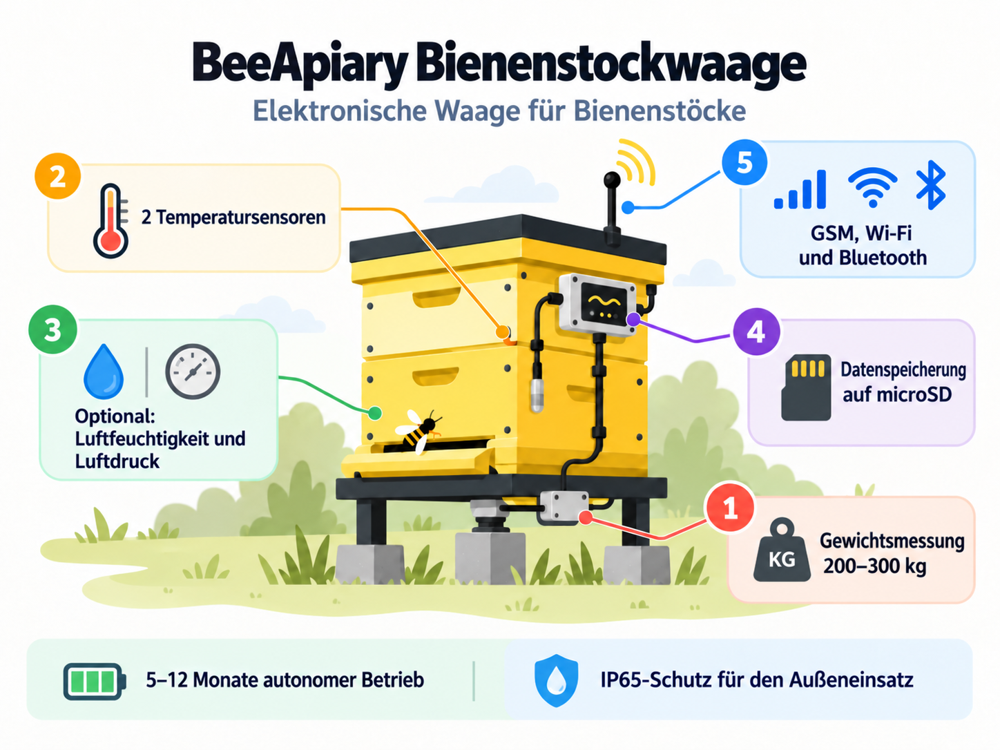

# Modelle und Zusatzausstattung der BeeApiary-Bienenstockwaage

Die BeeApiary-Bienenstockwaage ist in zwei Basiskonfigurationen erhältlich. Beide Konfigurationen können auf Wunsch um die aufgeführten Optionen ergänzt werden.

!!! note "Wie kaufen?"
    [**Basismodell bestellen oder kaufen**](https://www.olx.ua/d/obyavlenie/vagi-paschn-apiary-scales-vesy-pasechnye-vesy-gsm-wi-fi-dlya-paseki-IDUTO1F.html)
    {: .model-purchase-link }

    [**Verbessertes Modell mit Untergestell bestellen oder kaufen**](https://apkua.com/ru/agroboard/i-535929/vesy-pasechnye-vesy-gsm-wi-fi-dlya-paseki)
    {: .model-purchase-link }

### **Basismodell**

{ .doc-photo width="1500" height="1049" loading="lazy" decoding="async" }

Die Konfiguration umfasst vier Gewichtssensoren und zwei Temperatursensoren.

{ .model-option-image width="1448" height="1086" loading="lazy" decoding="async" }

### **Verbessertes Modell mit Untergestell ("kleines Plus")**

{ .doc-photo width="1327" height="1186" loading="lazy" decoding="async" }

Die Konfiguration umfasst ein spezielles Untergestell, einen verbesserten temperaturkompensierten Gewichtssensor und zwei Temperatursensoren.

{ .model-option-image width="1448" height="1086" loading="lazy" decoding="async" }

## Grundausstattung

| Bezeichnung | Foto | Preis |
|---|---|---|
| Haupteinheit | { .option-thumbnail width="400" height="400" loading="lazy" } | im Lieferumfang enthalten |
| microSD-Speicherkarte | { .option-thumbnail width="400" height="400" loading="lazy" } | im Lieferumfang enthalten |
| Zwei Temperatursensoren | { .option-thumbnail width="400" height="400" loading="lazy" } | im Lieferumfang enthalten |
| Gewichtssensor | Je nach Modell: vier einzelne Sensoren oder ein verbesserter Sensor mit Kreuzgestell. Siehe Modellfotos oben. | im Lieferumfang enthalten |
| Standardantenne | { .option-thumbnail width="400" height="400" loading="lazy" } | im Lieferumfang enthalten |
| Magnetschlüssel | { .option-thumbnail width="400" height="400" loading="lazy" } | im Lieferumfang enthalten |
| Standard-Akku | 18650 oder ein anderer Typ, je nach Modell | im Lieferumfang enthalten |

## Zusätzliche Optionen

| Zusätzliche Option | Foto | Ungefährer Preis |
|---|---|---|
| Zusätzlicher oder verstärkter Akku | 18650 oder ein anderer Typ, je nach Modell | ≈ 12 USD |
| Solarpanel zum regelmäßigen Nachladen | { .option-thumbnail width="400" height="400" loading="lazy" } | ≈ 12 USD |
| Verlängerte Antenne mit 3-m-Kabel | { .option-thumbnail width="400" height="400" loading="lazy" } | ≈ 12 USD |
| Feuchtigkeits- und Drucksensor | { .option-thumbnail width="400" height="400" loading="lazy" } | ≈ 12 USD |
| Kleines OLED-Display | { .option-thumbnail width="400" height="400" loading="lazy" } | ≈ 12 USD |
| Bewegungssensor |  | ≈ 12 USD |

Die angegebenen Preise sind Richtwerte. Verfügbarkeit, Kompatibilität mit der gewählten Konfiguration und Endpreis müssen bei der Bestellung bestätigt werden.

<noscript>Für den Rechner ist JavaScript erforderlich.</noscript>
