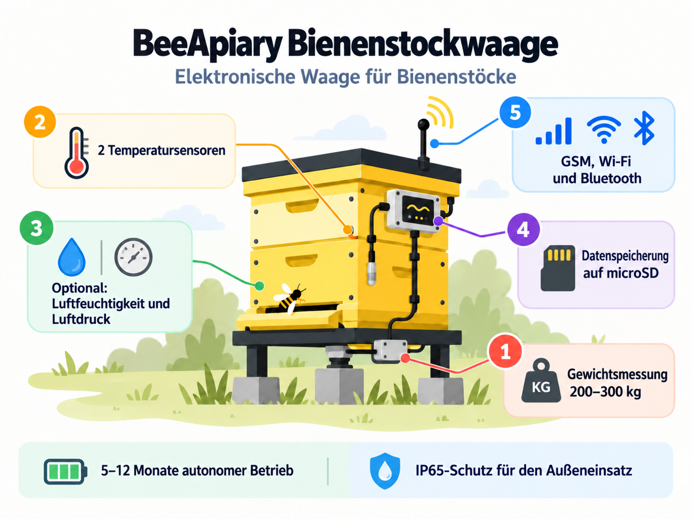

# Modelle und Zusatzausstattung der BeeApiary-Bienenstockwaage

Die BeeApiary-Bienenstockwaage ist in zwei Basiskonfigurationen erhältlich. Beide Konfigurationen können auf Wunsch um die aufgeführten Optionen ergänzt werden.

### Basismodell

Die Konfiguration umfasst vier Gewichtssensoren und zwei Temperatursensoren.

[Basismodell bestellen oder kaufen](https://www.olx.ua/d/obyavlenie/vagi-paschn-apiary-scales-vesy-pasechnye-vesy-gsm-wi-fi-dlya-paseki-IDUTO1F.html)

{ .model-option-image width="1448" height="1086" loading="lazy" decoding="async" }

### Verbessertes Modell mit Untergestell ("kleines Plus")

Die Konfiguration umfasst ein spezielles Untergestell, einen verbesserten temperaturkompensierten Gewichtssensor und zwei Temperatursensoren.

[Verbessertes Modell mit Untergestell bestellen oder kaufen](https://apkua.com/ru/agroboard/i-535929/vesy-pasechnye-vesy-gsm-wi-fi-dlya-paseki)

{ .model-option-image width="1448" height="1086" loading="lazy" decoding="async" }

## Zusätzliche Optionen

| Zusätzliche Option | Foto | Ungefährer Preis |
|---|---|---|
| Zusätzlicher verstärkter Akku |  | ≈ 12 USD |
| Solarpanel zum regelmäßigen Nachladen |  | ≈ 12 USD |
| Verlängerte Antenne mit 3-m-Kabel |  | ≈ 12 USD |
| Feuchtigkeits- und Drucksensor |  | ≈ 12 USD |
| Kleines OLED-Display |  | ≈ 12 USD |
| Bewegungssensor |  | ≈ 12 USD |

Die angegebenen Preise sind Richtwerte. Verfügbarkeit, Kompatibilität mit der gewählten Konfiguration und Endpreis müssen bei der Bestellung bestätigt werden.
