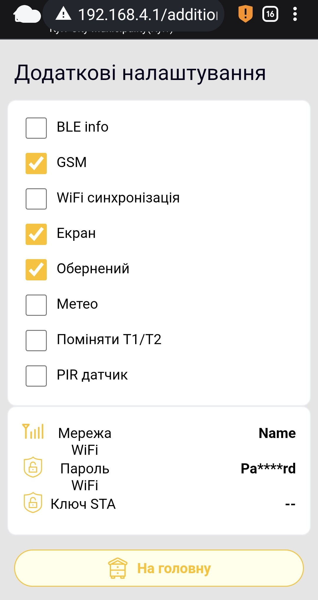

# Zusätzliche Geräteeinstellungen

Die Seite **Zusätzliche Einstellungen** gehört zur Weboberfläche der BeeApiary-Waage. Sie legt installierte optionale Hardware fest und steuert einzelne Datenübertragungskanäle.

## So öffnest du die Seite

1. [Verbinde dich mit dem Zugangspunkt des Geräts](../guides/configure-local-wifi.md).
2. Öffne `http://192.168.4.1`.
3. Wähle auf der Startseite **Zusätzliche Einstellungen**.
4. Lies die Warnung der Weboberfläche. Fahre nur fort, wenn du die Werte bewusst prüfen oder ändern möchtest.

!!! warning "Einstellungen nicht auf Verdacht ändern"
    Falsche Werte können den Betrieb stören. Aktiviere Hardwareoptionen nur, wenn die zugehörige Hardware tatsächlich installiert ist. Ändere Netzwerkwerte oder Schlüssel nicht ohne Grund.

{ .doc-screenshot }

Die gezeigten Netzwerkwerte sind Beispiele und unterscheiden sich von denen deines Geräts.

## Schalter

| Element | Funktion | Hinweis |
|---|---|---|
| **BLE info** | Aktiviert die lokale Datensynchronisierung über Bluetooth. | Richte danach die [Bluetooth-Synchronisierung in der App](../guides/configure-bluetooth-sync.md) ein. |
| **GSM** | Aktiviert das GSM-Modul und die Übertragung per SMS. | Deaktiviere es, wenn GSM nicht genutzt wird, etwa bei Winterlagerung ohne Übertragung. |
| **WiFi-Synchronisierung** | Aktiviert die automatische Übertragung über ein externes WLAN. | Wird üblicherweise automatisch aktiviert, wenn die App vorbereitete WLAN- und Cloud-Einstellungen überträgt. Ohne gültige Netzwerkfelder nicht manuell aktivieren. |
| **Bildschirm** | Teilt dem Gerät mit, dass ein OLED-Display eingebaut ist, und aktiviert es. | Nur bei vorhandenem Display aktivieren. |
| **Umgekehrt** | Dreht das OLED-Bild um 180°. | Nur bei aktiviertem **Bildschirm** relevant. |
| **Meteo** | Aktiviert den installierten Wettersensor für Druck, Luftfeuchtigkeit und eine zusätzliche Temperatur. | Nur bei vorhandenem Sensor aktivieren. |
| **T1/T2 tauschen** | Tauscht die übertragenen Werte der beiden Hauptthermometer. | Nützlich, wenn Innen- und Außensensor physisch vertauscht wurden. Kanalnamen und App-Einstellungen bleiben unverändert. |
| **PIR-Sensor** | Aktiviert den Alarmeingang für einen PIR- oder anderen kompatiblen Sensor zum Aufwecken des Systems. | Nur bei angeschlossenem Sensor aktivieren. |

## Netzwerkfelder

| Feld | Funktion | Hinweis |
|---|---|---|
| **WiFi-Netzwerk** | Name des externen WLANs, mit dem sich das Gerät verbindet. | Muss genau der am Gerät verfügbaren SSID entsprechen. |
| **WiFi-Passwort** | Passwort dieses WLANs. | Die Weboberfläche zeigt den Wert maskiert an. |
| **STA-Schlüssel** | Dienstschlüssel für die Übertragung, der bei der Registrierung in der App erstellt wird. | Nicht manuell bearbeiten. |

Am sichersten richtest du WLAN über die [Synchronisierung in der App](../guides/configure-wifi-sync.md) ein. Die App erstellt die nötigen Daten und überträgt sie über eine direkte Verbindung zu `apiary_net`.
