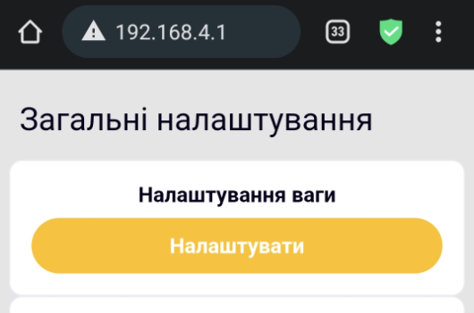

# Kalibrierung und Tarierung

!!! danger "Ein neues Gerät muss nicht kalibriert werden"
    Eine Kalibrierung ist hauptsächlich nach einer Reparatur oder dem Verlust der werkseitigen Kalibrierungsdaten erforderlich. Verwende sie nicht als allgemeines Verfahren zur Behebung eines falschen Gewichtswerts.

## Kalibrierung

1. Trenne die externe Stromversorgung.
2. Stelle alle Wägesensoren auf eine feste, ebene Fläche und lasse die Plattform leer.
3. Verbinde dich mit dem Zugangspunkt des Geräts und öffne in seiner Weboberfläche **Allgemeine Einstellungen → Waageneinstellungen**.

    { .doc-screenshot }

4. Starte die **Nullpunktkalibrierung** und warte, bis sie abgeschlossen ist, ohne die Plattform zu berühren.

    Der Bildschirm zeigt zwei Kalibrierungsschritte:

    { .doc-screenshot }

    { .doc-screenshot }

5. Wähle ein verfügbares Referenzgewicht von 500, 1000 oder 5000 g und lege es auf die Plattform.

    { .doc-screenshot }

6. Starte die **Referenzkalibrierung** und warte auf das Ergebnis.

    { .doc-screenshot }

    { .doc-screenshot }

Ergebnis: Das Gerät hat die neuen Kalibrierwerte gespeichert. Prüfe, ob das Referenzgewicht angezeigt wird.

## Tarierung

Beim Tarieren wird das Gewicht der Plattform oder einer anderen dauerhaften Konstruktion ausgeschlossen.

1. [Verbinde dich mit der Weboberfläche der Waage](../guides/configure-local-wifi.md).
2. Öffne **Allgemeine Einstellungen → Waageneinstellungen**.
3. Wähle eine Methode:

    - Ist das Taragewicht bekannt, gib es in Gramm ein und wähle **Taragewicht festlegen**.

        { .doc-screenshot }

    - Oder lasse die Konstruktion auf den Sensoren und übernimm den aktuellen Wert als null.

        { .doc-screenshot }

4. Prüfe anschließend den angezeigten Wert.

Ergebnis: Das Gerät zieht die Tara von den folgenden Messungen ab. Die Tarierung ändert den werkseitigen Kalibrierfaktor nicht.
