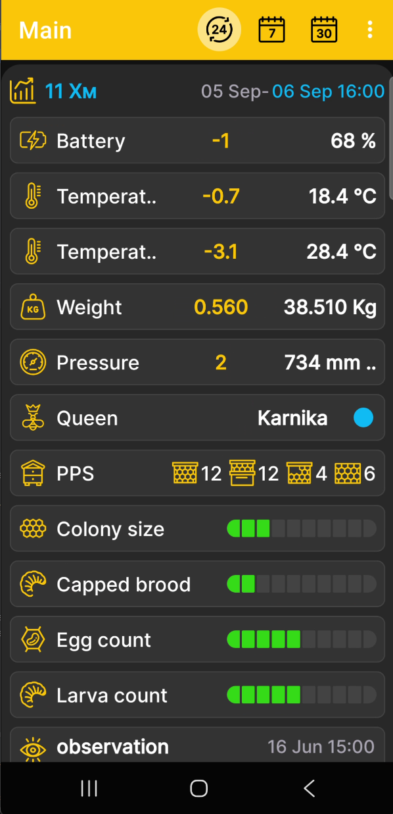

# App Home Screen

The home screen brings together numeric readings, hive state, and recent events for the selected hive or BeeApiary beehive scales. The app has no separate measurements screen: all available data forms a combined description of the hive.

{ .doc-screenshot }

## What Appears on the Screen

- the selected hive or BeeApiary hive scales;
- numeric readings for weight, temperature, humidity, pressure, and battery charge when the corresponding data is available;
- [hive status](hive-state.md), queen, frames, brood, and other profile records;
- the five most recent [events](events-and-notes.md) recorded by the user.

The available blocks depend on the data, sensors, and information entered for the selected hive.

Tile visibility and order are configured under [Select Data and Charts](chart-settings.md). Numeric values that change over time can also be displayed as [charts](charts.md). A [separate field setting](hive-state-settings.md) is available for the hive state.

## Period and Values

The icons at the top select the number of days, weeks or months through repeated taps.

{ .doc-screenshot .period-selection-icons width="314" height="89" }

Tap the date and time in the hive block to choose the end date. See [Chart Viewing Period](chart-period.md).

For each numeric reading:

- the latest measurement at the end of the selected period appears on the right in white;
- the change, or delta, between the values at the beginning and end of the selected period appears in yellow.

## Quick Navigation

Briefly tap the selected hive heading to open the [charts](charts.md). Touch and hold the heading to open [data selection and chart order](chart-settings.md).

- Swipe left to open the [hive state](hive-state.md), add a new record, or update the current one.
- Swipe right to open [events and notes](events-and-notes.md), add a new event, or edit an existing one.
