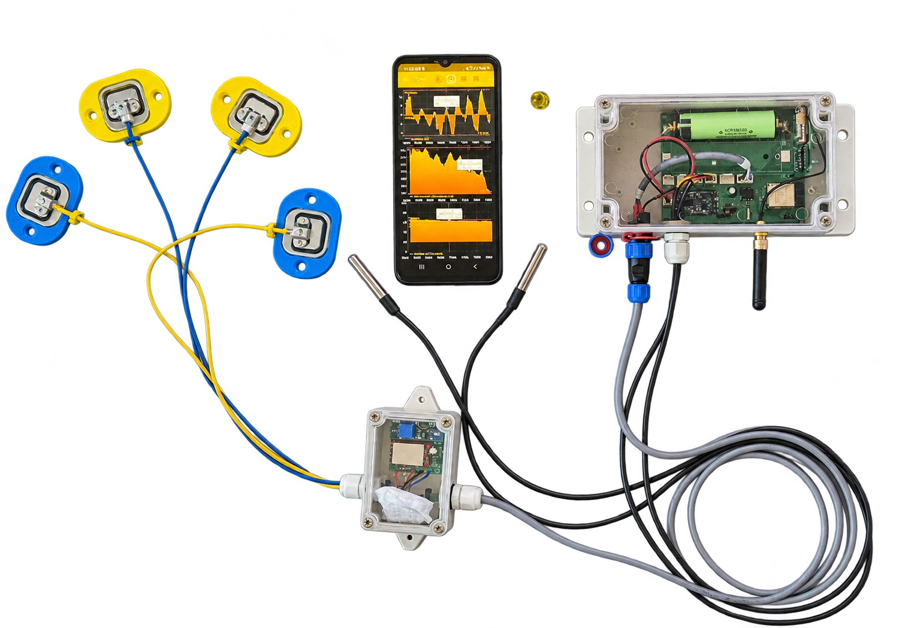
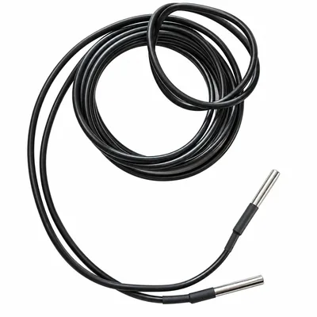

# BeeApiary Beehive Scale Models and Additional Options

BeeApiary beehive scales are available in two base configurations. Any of the listed options can be added to either configuration on request.

!!! note "How to buy?"
    [**Order or buy the basic model**](https://www.olx.ua/d/obyavlenie/vagi-paschn-apiary-scales-vesy-pasechnye-vesy-gsm-wi-fi-dlya-paseki-IDUTO1F.html)
    {: .model-purchase-link }

    [**Order or buy the improved model with support**](https://apkua.com/ru/agroboard/i-535929/vesy-pasechnye-vesy-gsm-wi-fi-dlya-paseki)
    {: .model-purchase-link }

### **Basic model**

{ .doc-photo width="1500" height="1049" loading="lazy" decoding="async" }

The configuration includes four load sensors and two temperature sensors.

{ .model-option-image width="1448" height="1086" loading="lazy" decoding="async" }

### **Improved model with support ("little plus")**

{ .doc-photo width="1327" height="1186" loading="lazy" decoding="async" }

The configuration includes a special support, an improved temperature-compensated load sensor and two temperature sensors.

{ .model-option-image width="1448" height="1086" loading="lazy" decoding="async" }

## Basic equipment

| Name | Photo | Price |
|---|---|---|
| Main unit | { .option-thumbnail width="400" height="400" loading="lazy" } | included |
| microSD memory card | { .option-thumbnail width="400" height="400" loading="lazy" } | included |
| Two temperature sensors | { .option-thumbnail width="400" height="400" loading="lazy" } | included |
| Weight sensor | Depending on the model: four separate sensors or one enhanced sensor with a cross-shaped support. See the model photos above. | included |
| Standard antenna | { .option-thumbnail width="400" height="400" loading="lazy" } | included |
| Magnetic key | { .option-thumbnail width="400" height="400" loading="lazy" } | included |
| Standard battery | 18650 or another type, depending on the model | included |

## Additional options

| Additional option | Photo | Approximate price |
|---|---|---|
| Additional or upgraded battery | 18650 or another type, depending on the model | ≈ 12 USD |
| Solar panel for periodic charging | { .option-thumbnail width="400" height="400" loading="lazy" } | ≈ 12 USD |
| Extended antenna with a 3 m cable | { .option-thumbnail width="400" height="400" loading="lazy" } | ≈ 12 USD |
| Humidity and pressure sensor | { .option-thumbnail width="400" height="400" loading="lazy" } | ≈ 12 USD |
| Compact OLED display | { .option-thumbnail width="400" height="400" loading="lazy" } | ≈ 12 USD |
| Motion sensor |  | ≈ 12 USD |

The prices shown are approximate. Confirm option availability, compatibility with the selected configuration and the final price when ordering.

<noscript>JavaScript is required for the calculator.</noscript>
