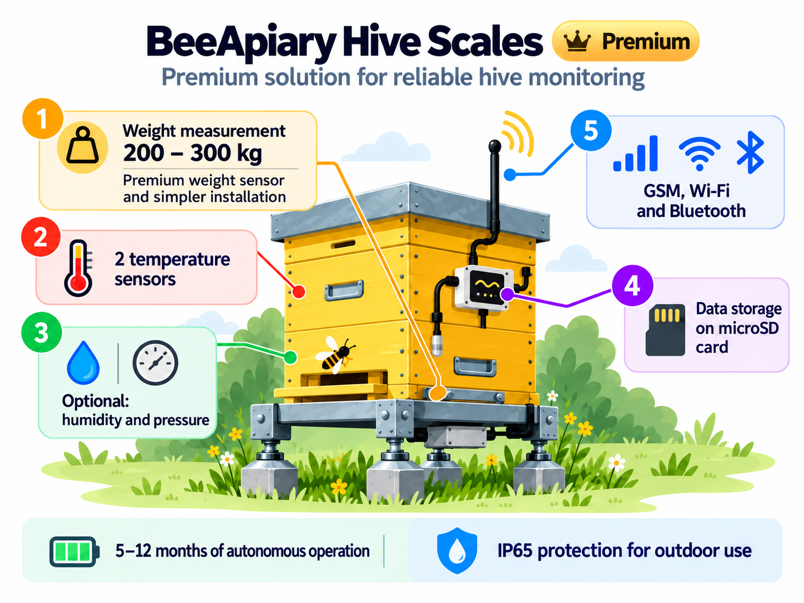

# BeeApiary Beehive Scale Models and Additional Options

BeeApiary beehive scales are available in two base configurations. Any of the listed options can be added to either configuration on request.

### Basic model

The configuration includes four load sensors and two temperature sensors.

[Order or buy the basic model](https://www.olx.ua/d/obyavlenie/vagi-paschn-apiary-scales-vesy-pasechnye-vesy-gsm-wi-fi-dlya-paseki-IDUTO1F.html)

{ .model-option-image width="1448" height="1086" loading="lazy" decoding="async" }

### Improved model with support ("little plus")

The configuration includes a special support, an improved temperature-compensated load sensor and two temperature sensors.

[Order or buy the improved model with support](https://apkua.com/ru/agroboard/i-535929/vesy-pasechnye-vesy-gsm-wi-fi-dlya-paseki)

{ .model-option-image width="1448" height="1086" loading="lazy" decoding="async" }

## Additional options

| Additional option | Photo | Approximate price |
|---|---|---|
| Additional upgraded battery |  | ≈ 12 USD |
| Solar panel for periodic charging |  | ≈ 12 USD |
| Extended antenna with a 3 m cable |  | ≈ 12 USD |
| Humidity and pressure sensor |  | ≈ 12 USD |
| Compact OLED display |  | ≈ 12 USD |
| Motion sensor |  | ≈ 12 USD |

The prices shown are approximate. Confirm option availability, compatibility with the selected configuration and the final price when ordering.
