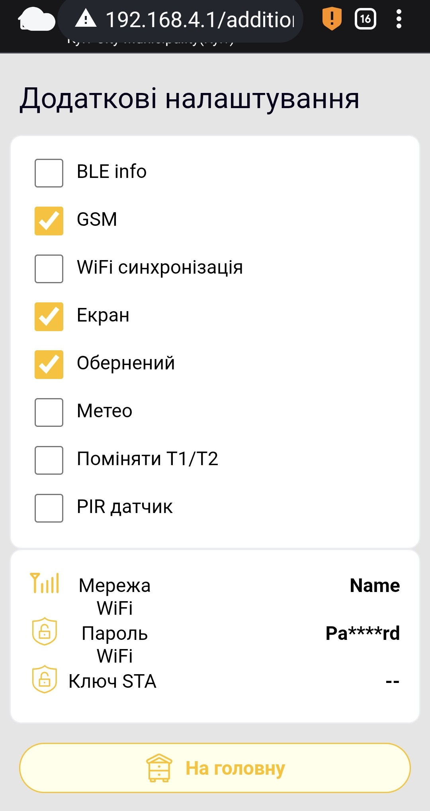

# Additional Device Settings

The **Additional settings** page belongs to the BeeApiary scales' web interface. It specifies installed optional hardware and controls individual data transmission channels.

## How to open it

1. [Connect to the device access point](../guides/configure-local-wifi.md).
2. Open `http://192.168.4.1`.
3. On the home page, select **Additional settings**.
4. Read the web interface warning. Continue only to deliberately check or change settings.

!!! warning "Do not change settings at random"
    Incorrect values can disrupt the device. Enable hardware options only when the corresponding equipment is physically installed. Do not change network settings or keys without a reason.

{ .doc-screenshot }

The network values shown are examples; yours will differ.

## Switches

| Item | Purpose | Notes |
|---|---|---|
| **BLE info** | Enables local Bluetooth data synchronization. | Then configure [Bluetooth synchronization in the app](../guides/configure-bluetooth-sync.md). |
| **GSM** | Enables the GSM module and SMS transmission. | Disable it when GSM is not used, for example during winter storage without transmission. |
| **WiFi synchronization** | Enables automatic transmission through an external Wi-Fi network. | Usually enabled automatically when the app transfers prepared Wi-Fi and cloud settings. Do not enable it manually without valid network fields. |
| **Screen** | Tells the device a physical OLED display is installed and enables it. | Enable only if the display is installed. |
| **Inverted** | Rotates the OLED image by 180°. | Relevant only when **Screen** is enabled. |
| **Meteo** | Enables the installed weather sensor for pressure, humidity and an additional temperature. | Enable only if the sensor is installed. |
| **Swap T1/T2** | Swaps the transmitted readings of the two main thermometers. | Useful if the inside and outside sensors were physically swapped; keep channel names and app settings unchanged. |
| **PIR sensor** | Enables the alarm input for a PIR or other compatible system wake-up sensor. | Enable only if a sensor is connected. |

## Network fields

| Field | Purpose | Notes |
|---|---|---|
| **WiFi network** | Name of the external Wi-Fi network used by the device. | Must exactly match the SSID available near the device. |
| **WiFi password** | Password of that network. | The web interface masks the value. |
| **STA key** | Service transmission key obtained during registration in the app. | Do not edit manually. |

It is safer to configure Wi-Fi through [synchronization setup in the app](../guides/configure-wifi-sync.md). The app prepares the data and transfers it during a direct connection to `apiary_net`.
