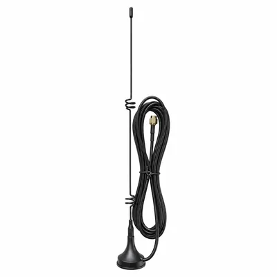
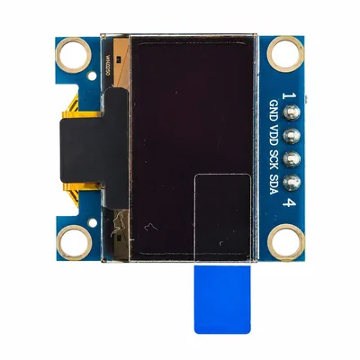

# Modelos y opciones adicionales de las básculas BeeApiary

Las básculas para colmenas BeeApiary están disponibles en dos configuraciones básicas. A cualquiera de ellas se le pueden añadir las opciones indicadas.

!!! note "¿Cómo comprar?"
    [**Encargar o comprar el modelo básico**](https://www.olx.ua/d/obyavlenie/vagi-paschn-apiary-scales-vesy-pasechnye-vesy-gsm-wi-fi-dlya-paseki-IDUTO1F.html)
    {: .model-purchase-link }

    [**Encargar o comprar el modelo mejorado con soporte**](https://apkua.com/ru/agroboard/i-535929/vesy-pasechnye-vesy-gsm-wi-fi-dlya-paseki)
    {: .model-purchase-link }

### **Modelo básico**

{ .doc-photo width="1500" height="1049" loading="lazy" decoding="async" }

La configuración incluye cuatro sensores de peso y dos sensores de temperatura.

{ .model-option-image width="1448" height="1086" loading="lazy" decoding="async" }

### **Modelo mejorado con soporte ("plusito")**

{ .doc-photo width="1327" height="1186" loading="lazy" decoding="async" }

La configuración incluye un soporte especial, un sensor de peso mejorado con compensación térmica y dos sensores de temperatura.

{ .model-option-image width="1448" height="1086" loading="lazy" decoding="async" }

## Equipamiento básico

| Nombre | Foto | Precio |
|---|---|---|
| Unidad principal | { .option-thumbnail width="400" height="400" loading="lazy" } | incluido en el equipo |
| Tarjeta de memoria microSD | { .option-thumbnail width="400" height="400" loading="lazy" } | incluido en el equipo |
| Dos sensores de temperatura | { .option-thumbnail width="400" height="400" loading="lazy" } | incluido en el equipo |
| Sensor de peso | Según el modelo: cuatro sensores independientes o un sensor mejorado con soporte en cruz. Consulte las fotos de los modelos anteriores. | incluido en el equipo |
| Antena básica | { .option-thumbnail width="400" height="400" loading="lazy" } | incluido en el equipo |
| Llave magnética | { .option-thumbnail width="400" height="400" loading="lazy" } | incluido en el equipo |
| Batería básica | 18650 u otro tipo, según el modelo | incluido en el equipo |

## Opciones adicionales

| Opción adicional | Foto | Precio aproximado |
|---|---|---|
| Batería adicional o reforzada | 18650 u otro tipo, según el modelo | ≈ 12 USD |
| Panel solar para recarga periódica | { .option-thumbnail width="400" height="400" loading="lazy" } | ≈ 12 USD |
| Antena alargada con cable de 3 m | { .option-thumbnail width="400" height="400" loading="lazy" } | ≈ 12 USD |
| Sensor de humedad y presión | { .option-thumbnail width="400" height="400" loading="lazy" } | ≈ 12 USD |
| Pantalla OLED pequeña | { .option-thumbnail width="400" height="400" loading="lazy" } | ≈ 12 USD |
| Sensor de movimiento |  | ≈ 12 USD |

Los precios indicados son aproximados. La disponibilidad, la compatibilidad con la configuración elegida y el precio final deben confirmarse al realizar el pedido.

<noscript>La calculadora requiere JavaScript.</noscript>
