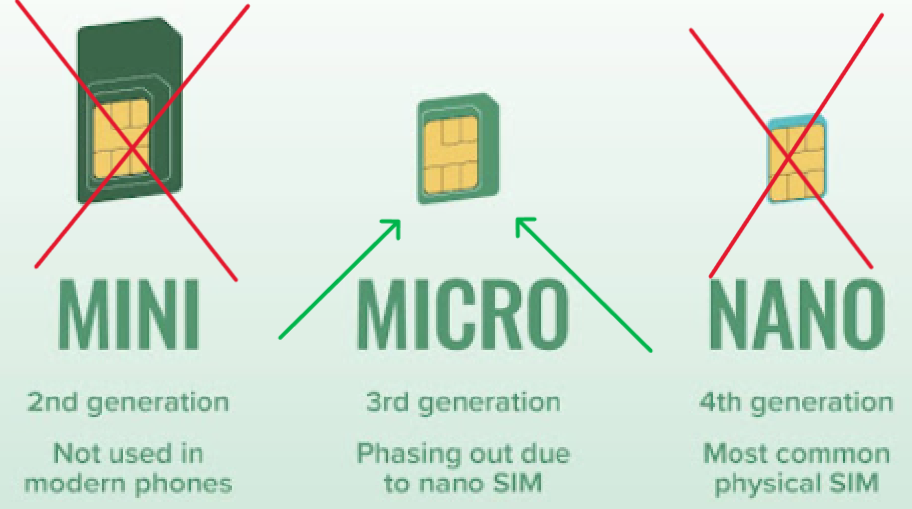

# Cómo configurar la báscula BeeApiary

1. Cargue el dispositivo a través de USB Type-C.

    !!! note "Elegir cargador y cable"
        El dispositivo no admite carga rápida, incluida la entrega de energía USB (PD). Utilice una fuente de alimentación estándar con un puerto USB tipo A y un cable USB tipo A-USB tipo C. No se recomienda un cable USB Type-C-USB Type-C para cargar.

2. Instale el dispositivo y los sensores según las [pautas de colocación](../device/placement.md).
3. Inserte una micro-SIM con la protección PIN desactivada.

    Utilice el formato micro-SIM:

    { .doc-photo }

    Tarjeta correctamente instalada:

    { .doc-photo }

    Inserta la tarjeta SIM y presiónala suavemente casi por completo en la ranura hasta que escuches un suave clic que confirme que está bloqueada en su lugar:

    { .doc-photo }

4. Active o reinicie el dispositivo: mantenga brevemente la llave magnética contra la marca en la parte posterior de la unidad principal.

    { .doc-photo }

    { .doc-photo }

5. Si necesitas comprobar o cambiar ajustes, [conéctate a `apiary_net`](configure-local-wifi.md) y abre `http://192.168.4.1`. De lo contrario, omite este paso.
6. El fabricante suele configurar el número del propietario. Solo si es necesario, [comprueba, cambia o elimina el número en los ajustes GSM](configure-gsm.md).
7. Si te conectaste a `apiary_net`, desconéctate. Espera el primer SMS: suele llegar antes de que el dispositivo entre en reposo, aproximadamente un minuto después de desconectarlo o activarlo.

    Tras cambiar los ajustes de transmisión, la calibración u otros parámetros, puede ser necesario esperar a que el dispositivo entre en reposo y activarlo de nuevo con la llave magnética, sin volver a conectarse a `apiary_net`.

Resultado: el dispositivo recopila mediciones, las envía al propietario y almacena un archivo.
