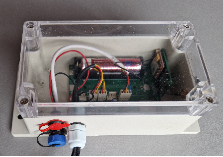

# Configuración del sistema

!!! danger "Atención: el dispositivo ya está completamente configurado"
    Nuevo BeeApiary Las básculas para colmenas se suministran configuradas y calibradas. El número de usuario ya está almacenado en la configuración de la báscula, por lo que no es necesario volver a configurarla.

    No hagas cambios por tu cuenta. Por lo general, sólo necesita completar los primeros cuatro pasos a continuación para que todo funcione.

    No retire la batería, tara ni calibre la báscula, ni cambie ningún ajuste sin antes leer hasta el final las instrucciones pertinentes. Se desaconseja encarecidamente hacerlo durante la configuración inicial.

!!! warning "Antes de instalar la tarjeta SIM"
    Utilice únicamente una micro-SIM y desactive su protección PIN de antemano.

    { .doc-photo }

1. Abra la tapa de la unidad de recopilación de datos.

    { .doc-photo }

2. Inserte la micro-SIM en la ranura correspondiente.

    Posición correcta de la tarjeta:

    La ubicación del módulo GSM cambia entre las placas anteriores a 2026 y las versiones más recientes desde 2026.

    **Placa anterior (antes de 2026):**

    { .doc-photo }

    **Placa más reciente (desde 2026):**

    { .doc-photo }

    Inserta la tarjeta SIM y presiónala suavemente hasta que esté casi completamente encajada en la ranura y escuches un ligero clic que confirma que está bloqueada en su lugar:

    **Placa anterior (antes de 2026):**

    { .doc-photo }

    **Placa más reciente (desde 2026):**

    { .doc-photo }

3. [Activar o reiniciar el dispositivo](../guides/set-up-device.md#activation-reset): mantenga brevemente la llave magnética contra la marca en la parte posterior de la unidad principal.

    { .doc-photo }

    { .doc-photo }

4. Espere aproximadamente un minuto y confirme que llega el primer SMS al número de usuario preconfigurado.

Hecho. Felicitaciones: el dispositivo recopila datos, los envía a través de GSM y mantiene un archivo local.

## Aplicación: si es necesario

La aplicación BeeApiary no es necesaria para recibir SMS normales ni es una parte indispensable de la báscula. La báscula funciona de forma autónoma y envía datos por SMS a cualquier teléfono. Instala la aplicación para consultar gráficos, analizar mediciones, llevar un diario del apiario, identificar colmenas y usar sus demás funciones.

1. [Instale el BeeApiary aplicación](app-only.md) y asegúrese de otorgarle permiso para procesar mensajes SMS.
2. En la aplicación, seleccione **Agregar dispositivo**.
3. Introduce el número de la micro-SIM instalada en el BeeApiary balanzas de colmena.

!!! note
    Ingrese el número de la tarjeta SIM instalada en el dispositivo, no el número de teléfono del usuario.

Si el primer SMS no llega, no cambies la configuración al azar. Ver [No se recibieron SMS](../troubleshooting/no-sms.md). Cambie el número de usuario a través de [Configuración GSM](../guides/configure-gsm.md) sólo cuando sea necesario.

- [Instalar la tarjeta SIM: placa anterior (antes de 2026)](https://www.youtube.com/shorts/GF2KLso4DMo)
- [Instalar la tarjeta SIM: placa más reciente (desde 2026)](https://www.youtube.com/watch?v=g_5MQBxkzY0)

Más información: [GSM y SMS](../system/gsm-and-sms.md) y [Flujo de datos](../system/data-flow.md).
