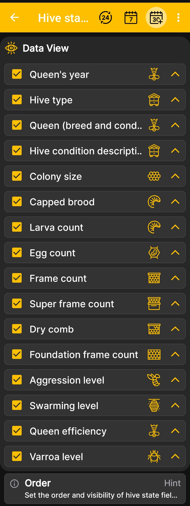

# Ordre de terrain de l'État de la ruche

Cet écran contrôle la visibilité et l'ordre des champs dans la fenêtre développée. [état de la ruche](hive-state.md).

1. Ouvert **Menu principal → Paramètres → Ordre des champs d'état de la ruche**.
2. Gardez les cases cochées à côté des informations que vous souhaitez afficher.
3. Décochez les cases des champs qui ne sont pas utilisés dans votre rucher.
4. Utilisez les flèches à droite pour déplacer les champs les plus importants vers le haut.

{ .doc-screenshot }

Tu peux par exemple afficher ou masquer l’année de la reine, la force de la colonie ou le nombre de cadres. Tous les champs sont décrits dans [l’état de la ruche](hive-state.md).

La modification de l'ordre affecte la façon dont les données sont présentées dans l'application, mais ne modifie pas les enregistrements de ruche stockés.
