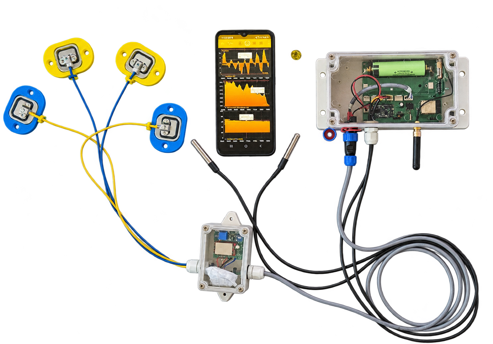
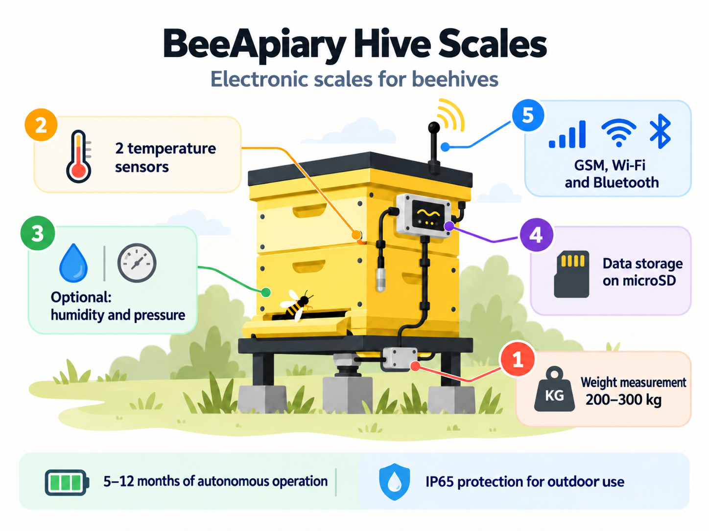
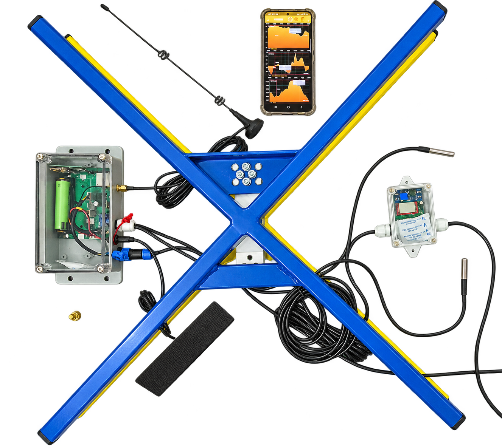
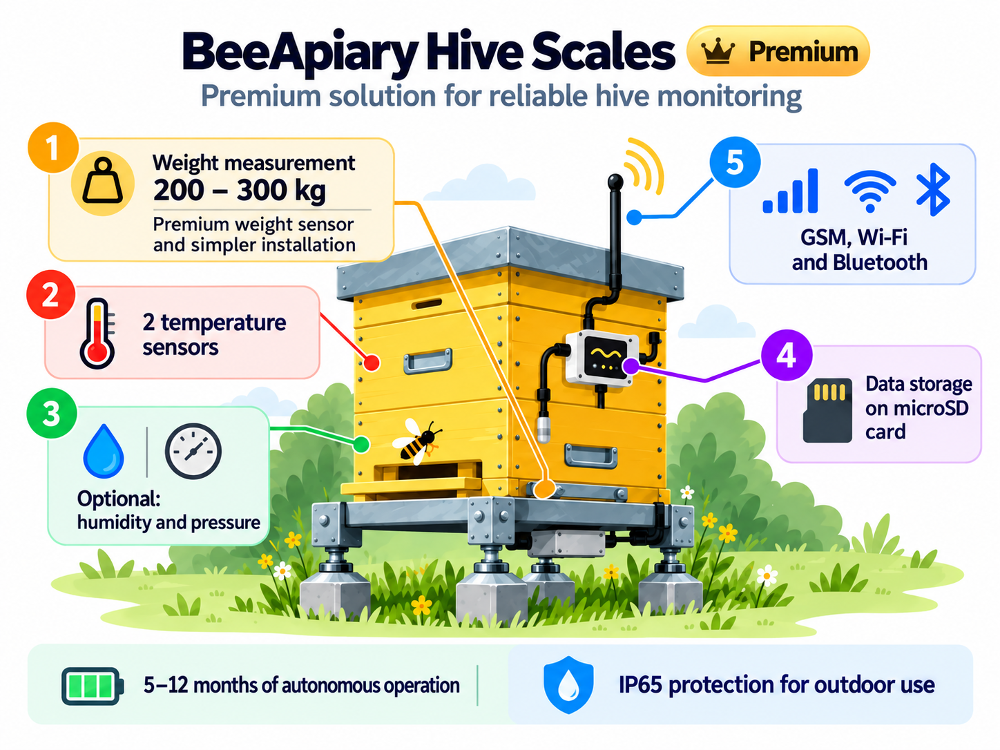

# Modèles et options supplémentaires des balances BeeApiary

Les balances de ruche BeeApiary sont disponibles en deux configurations de base. Chacune peut recevoir les options proposées selon les besoins.

### **Modèle de base**

[Commander ou acheter le modèle de base](https://www.olx.ua/d/obyavlenie/vagi-paschn-apiary-scales-vesy-pasechnye-vesy-gsm-wi-fi-dlya-paseki-IDUTO1F.html)

{ .doc-photo width="1500" height="1049" loading="lazy" decoding="async" }

La configuration comprend quatre capteurs de pesée et deux capteurs de température.

{ .model-option-image width="1448" height="1086" loading="lazy" decoding="async" }

### **Modèle amélioré avec support ("petit plus")**

[Commander ou acheter le modèle amélioré avec support](https://apkua.com/ru/agroboard/i-535929/vesy-pasechnye-vesy-gsm-wi-fi-dlya-paseki)

{ .doc-photo width="1327" height="1186" loading="lazy" decoding="async" }

La configuration comprend un support spécial, un capteur de pesée amélioré et compensé en température, ainsi que deux capteurs de température.

{ .model-option-image width="1448" height="1086" loading="lazy" decoding="async" }

## Options supplémentaires

| Option supplémentaire | Photo | Prix approximatif |
|---|---|---|
| Batterie renforcée supplémentaire |  | ≈ 12 USD |
| Panneau solaire pour recharge périodique |  | ≈ 12 USD |
| Antenne rallongée avec câble de 3 m |  | ≈ 12 USD |
| Capteur d’humidité et de pression |  | ≈ 12 USD |
| Petit écran OLED |  | ≈ 12 USD |
| Détecteur de mouvement |  | ≈ 12 USD |

Les prix indiqués sont approximatifs. La disponibilité des options, leur compatibilité avec la configuration choisie et le prix final doivent être confirmés lors de la commande.

<noscript>JavaScript est nécessaire pour utiliser le calculateur.</noscript>
