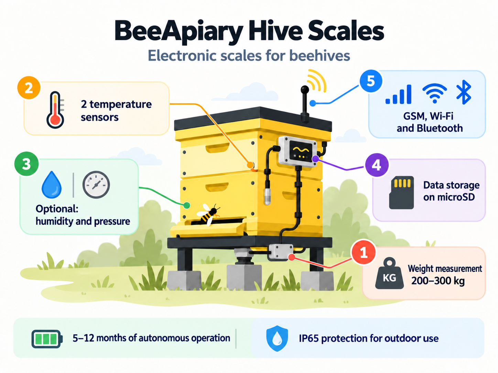
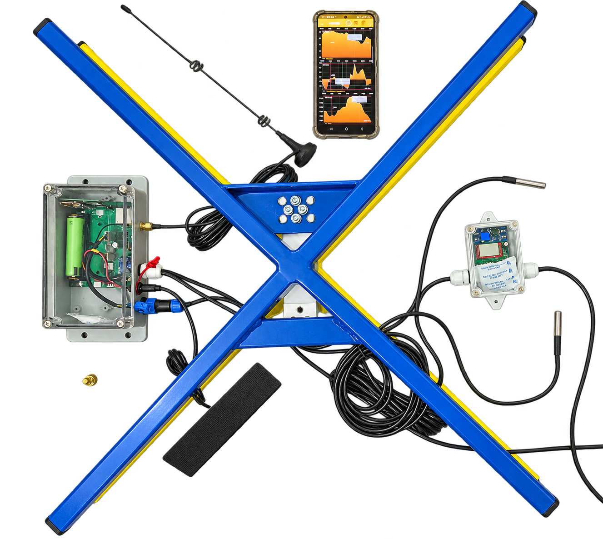
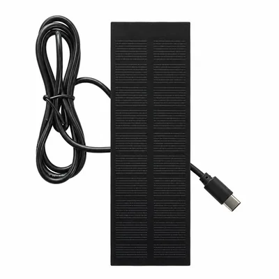

# Modèles et options supplémentaires des balances BeeApiary

Les balances de ruche BeeApiary sont disponibles en deux configurations de base. Chacune peut recevoir les options proposées selon les besoins.

!!! note "Comment acheter ?"
    [**Commander ou acheter le modèle de base**](https://www.olx.ua/d/obyavlenie/vagi-paschn-apiary-scales-vesy-pasechnye-vesy-gsm-wi-fi-dlya-paseki-IDUTO1F.html)
    {: .model-purchase-link }

    [**Commander ou acheter le modèle amélioré avec support**](https://apkua.com/ru/agroboard/i-535929/vesy-pasechnye-vesy-gsm-wi-fi-dlya-paseki)
    {: .model-purchase-link }

### **Modèle de base**

{ .doc-photo width="1500" height="1049" loading="lazy" decoding="async" }

La configuration comprend quatre capteurs de pesée et deux capteurs de température.

{ .model-option-image width="1448" height="1086" loading="lazy" decoding="async" }

### **Modèle amélioré avec support ("petit plus")**

{ .doc-photo width="1327" height="1186" loading="lazy" decoding="async" }

La configuration comprend un support spécial, un capteur de pesée amélioré et compensé en température, ainsi que deux capteurs de température.

{ .model-option-image width="1448" height="1086" loading="lazy" decoding="async" }

## Équipement de base

| Nom | Photo | Prix |
|---|---|---|
| Unité principale | { .option-thumbnail width="400" height="400" loading="lazy" } | inclus dans le kit |
| Carte mémoire microSD | { .option-thumbnail width="400" height="400" loading="lazy" } | inclus dans le kit |
| Deux capteurs de température | { .option-thumbnail width="400" height="400" loading="lazy" } | inclus dans le kit |
| Capteur de poids | Selon le modèle : quatre capteurs distincts ou un capteur amélioré avec support en croix. Voir les photos des modèles ci-dessus. | inclus dans le kit |
| Antenne standard | { .option-thumbnail width="400" height="400" loading="lazy" } | inclus dans le kit |
| Clé magnétique | { .option-thumbnail width="400" height="400" loading="lazy" } | inclus dans le kit |
| Batterie standard | 18650 ou autre type, selon le modèle | inclus dans le kit |

## Options supplémentaires

| Option supplémentaire | Photo | Prix approximatif |
|---|---|---|
| Batterie supplémentaire ou renforcée | 18650 ou autre type, selon le modèle | ≈ 12 USD |
| Panneau solaire pour recharge périodique | { .option-thumbnail width="400" height="400" loading="lazy" } | ≈ 12 USD |
| Antenne rallongée avec câble de 3 m | { .option-thumbnail width="400" height="400" loading="lazy" } | ≈ 12 USD |
| Capteur d’humidité et de pression | { .option-thumbnail width="400" height="400" loading="lazy" } | ≈ 12 USD |
| Petit écran OLED | { .option-thumbnail width="400" height="400" loading="lazy" } | ≈ 12 USD |
| Détecteur de mouvement |  | ≈ 12 USD |

Les prix indiqués sont approximatifs. La disponibilité des options, leur compatibilité avec la configuration choisie et le prix final doivent être confirmés lors de la commande.

<noscript>JavaScript est nécessaire pour utiliser le calculateur.</noscript>
