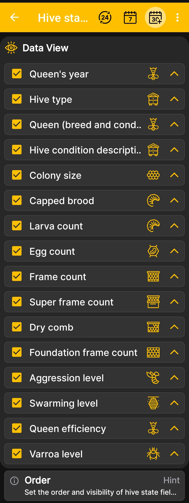

# Kolejność pola stanu ula

Ten ekran kontroluje widoczność i kolejność pól w rozwinięciu [stan ula](hive-state.md).

1. Otwórz **Menu główne → Ustawienia → kolejność pól stanu ula**.
2. Pozostaw zaznaczone pola wyboru obok informacji, które chcesz wyświetlić.
3. Usuń zaznaczenia pól, które nie są używane w Twojej pasiece.
4. Użyj strzałek po prawej stronie, aby przenieść ważniejsze pola wyżej.

{ .doc-screenshot }

Można na przykład zmienić wyświetlanie roku matki, siły rodziny lub liczby ramek. Wszystkie pola opisano na stronie [stanu ula](hive-state.md).

Zmiana kolejności wpływa na prezentację danych w aplikacji, ale nie powoduje zmiany przechowywanych rekordów ula.
