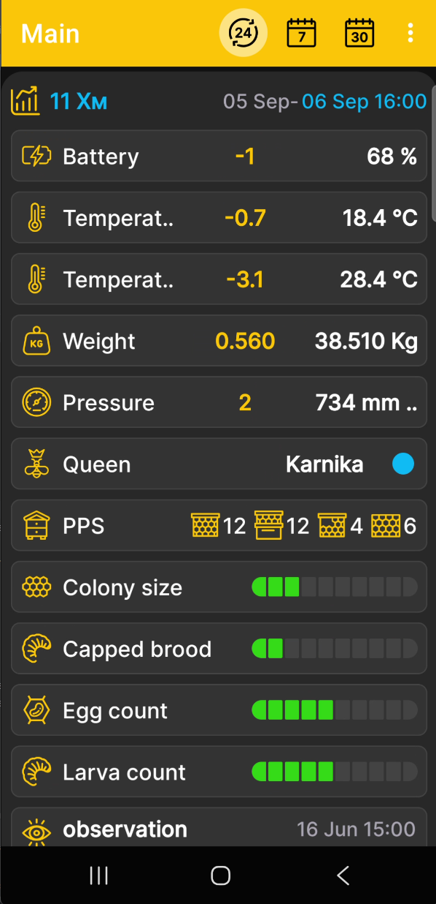
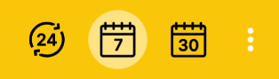

# Ekran główny aplikacji

Na ekranie głównym znajdują się odczyty numeryczne, stan ula i ostatnie wydarzenia dla wybranego ula BeeApiary wagi do ula. Aplikacja nie posiada osobnego ekranu pomiarów: wszystkie dostępne dane tworzą łączny opis ula.

{ .doc-screenshot }

## Co pojawia się na ekranie

- wybrany ul lub BeeApiary wagi do ula;
- odczyty numeryczne masy, temperatury, wilgotności, ciśnienia i poziomu naładowania akumulatora, jeśli dostępne są odpowiednie dane;
- [stan ula](hive-state.md), królowa, klatki, czerwie i inne zapisy profilowe;
- pięć najnowszych [wydarzenia](events-and-notes.md) nagrane przez użytkownika.

Dostępne bloki zależą od danych, czujników i informacji wprowadzonych dla wybranego ula.

Widoczność i kolejność kafelków konfiguruje się w zakładce [Wybierz Dane i wykresy](chart-settings.md). Wartości numeryczne zmieniające się w czasie można również wyświetlić jako [wykresy](charts.md). [oddzielne ustawienie pola](hive-state-settings.md) jest dostępny dla stanu ula.

## Okres i wartości

Kolejne naciśnięcia ikon u góry wybierają liczbę dni, tygodni lub miesięcy.

{ .doc-screenshot .period-selection-icons width="314" height="89" }

Naciśnij datę i godzinę w bloku ula, aby wybrać datę końcową. Zobacz [Okres wykresów](chart-period.md).

Dla każdego odczytu liczbowego:

- ostatni pomiar na koniec wybranego okresu pojawia się po prawej stronie w kolorze białym;
- zmiana lub delta pomiędzy wartościami na początku i na końcu wybranego okresu jest wyświetlana na żółto.

## Szybka nawigacja

Krótko dotknij wybranego nagłówka ula, aby otworzyć [wykresy](charts.md). Kliknij i przytrzymaj nagłówek, aby go otworzyć [wybór danych i kolejność na wykresie](chart-settings.md).

- Przesuń w lewo, aby otworzyć [stan ula](hive-state.md), dodaj nowy rekord lub zaktualizuj bieżący.
- Przesuń w prawo, aby otworzyć [wydarzenia i notatki](events-and-notes.md), dodaj nowe wydarzenie lub edytuj istniejące.
