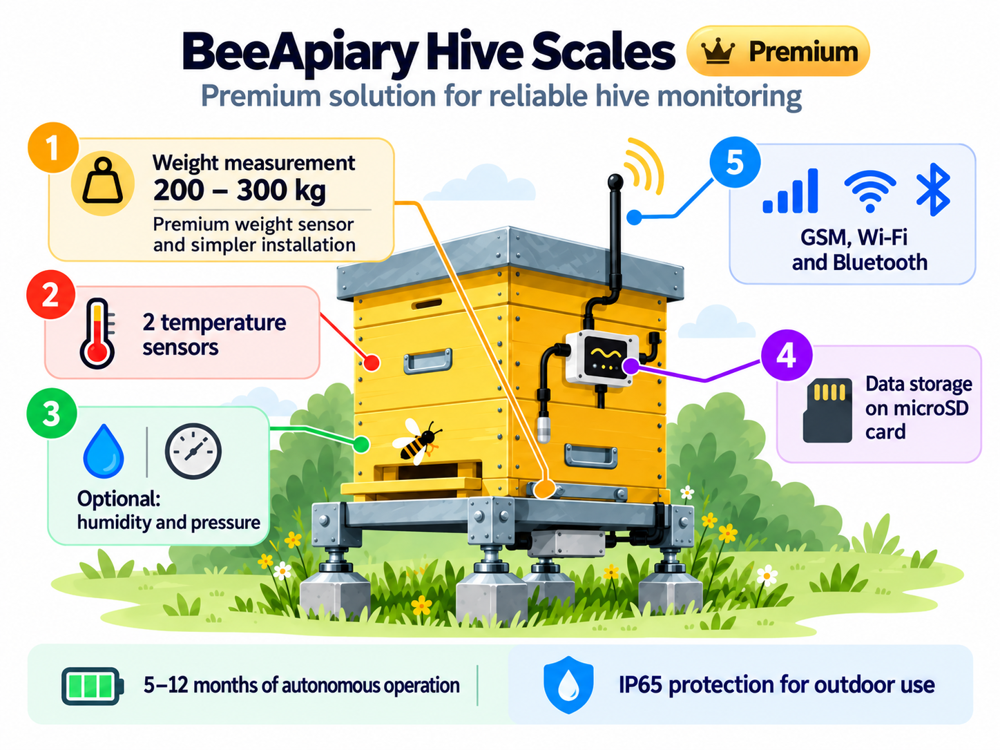
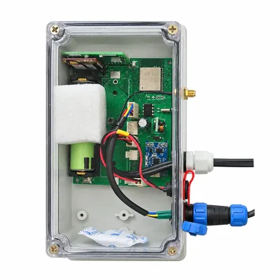
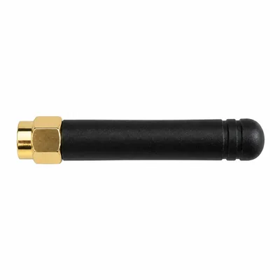

# Modele i opcje dodatkowe wag pasiecznych BeeApiary

Wagi pasieczne BeeApiary są dostępne w dwóch podstawowych konfiguracjach. Do każdej z nich można na życzenie dodać wymienione opcje.

!!! note "Jak kupić?"
    [**Zamów lub kup model podstawowy**](https://www.olx.ua/d/obyavlenie/vagi-paschn-apiary-scales-vesy-pasechnye-vesy-gsm-wi-fi-dlya-paseki-IDUTO1F.html)
    {: .model-purchase-link }

    [**Zamów lub kup ulepszony model z podstawą**](https://apkua.com/ru/agroboard/i-535929/vesy-pasechnye-vesy-gsm-wi-fi-dlya-paseki)
    {: .model-purchase-link }

### **Model podstawowy**

{ .doc-photo width="1500" height="1049" loading="lazy" decoding="async" }

Konfiguracja obejmuje cztery czujniki wagowe i dwa czujniki temperatury.

{ .model-option-image width="1448" height="1086" loading="lazy" decoding="async" }

### **Ulepszony model z podstawą ("plusik")**

{ .doc-photo width="1327" height="1186" loading="lazy" decoding="async" }

Konfiguracja obejmuje specjalną podstawę, ulepszony czujnik wagowy z kompensacją temperatury i dwa czujniki temperatury.

{ .model-option-image width="1448" height="1086" loading="lazy" decoding="async" }

## Wyposażenie podstawowe

| Nazwa | Zdjęcie | Cena |
|---|---|---|
| Jednostka główna | { .option-thumbnail width="400" height="400" loading="lazy" } | w zestawie |
| Karta pamięci microSD | { .option-thumbnail width="400" height="400" loading="lazy" } | w zestawie |
| Dwa czujniki temperatury | { .option-thumbnail width="400" height="400" loading="lazy" } | w zestawie |
| Czujnik masy | W zależności od modelu: cztery oddzielne czujniki lub jeden ulepszony czujnik z podstawą krzyżową. Zobacz zdjęcia modeli powyżej. | w zestawie |
| Antena podstawowa | { .option-thumbnail width="400" height="400" loading="lazy" } | w zestawie |
| Klucz magnetyczny | { .option-thumbnail width="400" height="400" loading="lazy" } | w zestawie |
| Akumulator podstawowy | 18650 lub inny typ, zależnie od modelu | w zestawie |

## Opcje dodatkowe

| Opcja dodatkowa | Zdjęcie | Orientacyjna cena |
|---|---|---|
| Dodatkowy lub wzmocniony akumulator | 18650 lub inny typ, zależnie od modelu | ≈ 12 USD |
| Panel słoneczny do okresowego ładowania | { .option-thumbnail width="400" height="400" loading="lazy" } | ≈ 12 USD |
| Przedłużona antena z kablem 3 m | { .option-thumbnail width="400" height="400" loading="lazy" } | ≈ 12 USD |
| Czujnik wilgotności i ciśnienia | { .option-thumbnail width="400" height="400" loading="lazy" } | ≈ 12 USD |
| Mały wyświetlacz OLED | { .option-thumbnail width="400" height="400" loading="lazy" } | ≈ 12 USD |
| Czujnik ruchu |  | ≈ 12 USD |

Podane ceny są orientacyjne. Dostępność opcji, zgodność z wybraną konfiguracją i ostateczną cenę należy potwierdzić podczas składania zamówienia.

<noscript>Kalkulator wymaga obsługi JavaScript.</noscript>
