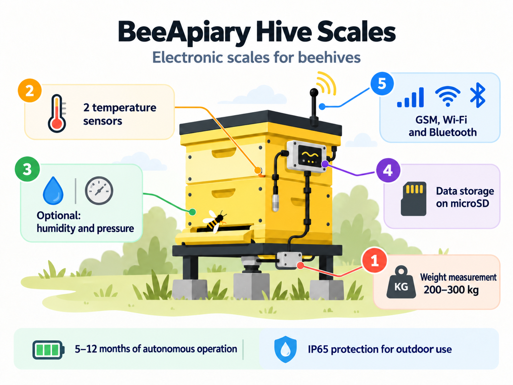
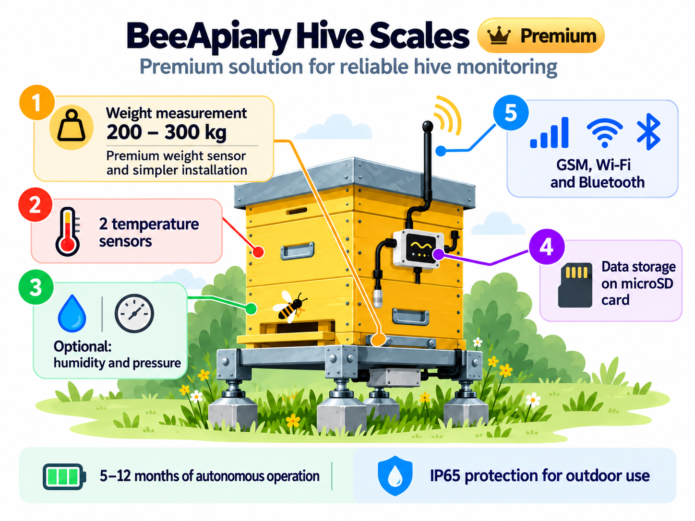

# Modele i opcje dodatkowe wag pasiecznych BeeApiary

Wagi pasieczne BeeApiary są dostępne w dwóch podstawowych konfiguracjach. Do każdej z nich można na życzenie dodać wymienione opcje.

### **Model podstawowy**

[Zamów lub kup model podstawowy](https://www.olx.ua/d/obyavlenie/vagi-paschn-apiary-scales-vesy-pasechnye-vesy-gsm-wi-fi-dlya-paseki-IDUTO1F.html)

{ .doc-photo width="1500" height="1049" loading="lazy" decoding="async" }

Konfiguracja obejmuje cztery czujniki wagowe i dwa czujniki temperatury.

{ .model-option-image width="1448" height="1086" loading="lazy" decoding="async" }

### **Ulepszony model z podstawą ("plusik")**

[Zamów lub kup ulepszony model z podstawą](https://apkua.com/ru/agroboard/i-535929/vesy-pasechnye-vesy-gsm-wi-fi-dlya-paseki)

{ .doc-photo width="1327" height="1186" loading="lazy" decoding="async" }

Konfiguracja obejmuje specjalną podstawę, ulepszony czujnik wagowy z kompensacją temperatury i dwa czujniki temperatury.

{ .model-option-image width="1448" height="1086" loading="lazy" decoding="async" }

## Opcje dodatkowe

| Opcja dodatkowa | Zdjęcie | Orientacyjna cena |
|---|---|---|
| Dodatkowy wzmocniony akumulator |  | ≈ 12 USD |
| Panel słoneczny do okresowego ładowania |  | ≈ 12 USD |
| Przedłużona antena z kablem 3 m |  | ≈ 12 USD |
| Czujnik wilgotności i ciśnienia |  | ≈ 12 USD |
| Mały wyświetlacz OLED |  | ≈ 12 USD |
| Czujnik ruchu |  | ≈ 12 USD |

Podane ceny są orientacyjne. Dostępność opcji, zgodność z wybraną konfiguracją i ostateczną cenę należy potwierdzić podczas składania zamówienia.

<noscript>Kalkulator wymaga obsługi JavaScript.</noscript>
