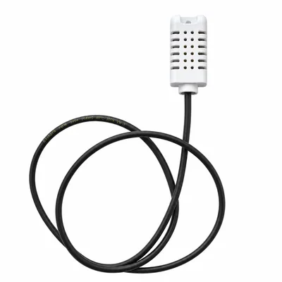

# Modelos e opções adicionais das balanças BeeApiary

As balanças para colmeias BeeApiary estão disponíveis em duas configurações básicas. As opções listadas podem ser adicionadas a qualquer uma delas conforme necessário.

!!! note "Como comprar?"
    [**Encomendar ou comprar o modelo básico**](https://www.olx.ua/d/obyavlenie/vagi-paschn-apiary-scales-vesy-pasechnye-vesy-gsm-wi-fi-dlya-paseki-IDUTO1F.html)
    {: .model-purchase-link }

    [**Encomendar ou comprar o modelo aprimorado com suporte**](https://apkua.com/ru/agroboard/i-535929/vesy-pasechnye-vesy-gsm-wi-fi-dlya-paseki)
    {: .model-purchase-link }

### **Modelo básico**

{ .doc-photo width="1500" height="1049" loading="lazy" decoding="async" }

A configuração inclui quatro sensores de peso e dois sensores de temperatura.

{ .model-option-image width="1448" height="1086" loading="lazy" decoding="async" }

### **Modelo aprimorado com suporte ("pluszinho")**

{ .doc-photo width="1327" height="1186" loading="lazy" decoding="async" }

A configuração inclui um suporte especial, um sensor de peso aprimorado com compensação térmica e dois sensores de temperatura.

{ .model-option-image width="1448" height="1086" loading="lazy" decoding="async" }

## Equipamento básico

| Nome | Foto | Preço |
|---|---|---|
| Unidade principal | { .option-thumbnail width="400" height="400" loading="lazy" } | incluído no conjunto |
| Cartão de memória microSD | { .option-thumbnail width="400" height="400" loading="lazy" } | incluído no conjunto |
| Dois sensores de temperatura | { .option-thumbnail width="400" height="400" loading="lazy" } | incluído no conjunto |
| Sensor de peso | Conforme o modelo: quatro sensores separados ou um sensor aprimorado com suporte em cruz. Veja as fotos dos modelos acima. | incluído no conjunto |
| Antena básica | { .option-thumbnail width="400" height="400" loading="lazy" } | incluído no conjunto |
| Chave magnética | { .option-thumbnail width="400" height="400" loading="lazy" } | incluído no conjunto |
| Bateria básica | 18650 ou outro tipo, conforme o modelo | incluído no conjunto |

## Opções adicionais

| Opção adicional | Foto | Preço aproximado |
|---|---|---|
| Bateria adicional ou reforçada | 18650 ou outro tipo, conforme o modelo | ≈ 12 USD |
| Painel solar para recarga periódica | { .option-thumbnail width="400" height="400" loading="lazy" } | ≈ 12 USD |
| Antena estendida com cabo de 3 m | { .option-thumbnail width="400" height="400" loading="lazy" } | ≈ 12 USD |
| Sensor de umidade e pressão | { .option-thumbnail width="400" height="400" loading="lazy" } | ≈ 12 USD |
| Pequena tela OLED | { .option-thumbnail width="400" height="400" loading="lazy" } | ≈ 12 USD |
| Sensor de movimento |  | ≈ 12 USD |

Os preços informados são aproximados. A disponibilidade das opções, a compatibilidade com a configuração escolhida e o preço final devem ser confirmados no momento do pedido.

<noscript>O cálculo requer JavaScript.</noscript>
