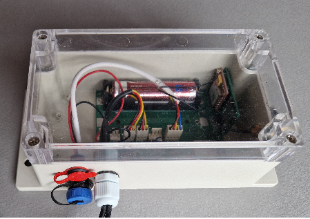

# Configuração do sistema

!!! danger "Atenção: o dispositivo já está totalmente configurado"
    Novo BeeApiary balanças de colmeia são fornecidas configuradas e calibradas. O número do usuário já está armazenado nas configurações da balança, portanto não é necessário reconfigurá-la.

    Não faça alterações por conta própria. Normalmente, você só precisa concluir as quatro primeiras etapas abaixo para que tudo funcione.

    Não remova a bateria, tare ou calibre as balanças, nem altere quaisquer configurações sem primeiro ler as instruções relevantes até o final. Fazer isso durante a configuração inicial é fortemente desencorajado.

!!! warning "Antes de instalar o cartão SIM"
    Use apenas um micro-SIM e desative a proteção PIN antecipadamente.

    { .doc-photo }

1. Abra a tampa da unidade de coleta de dados.

    { .doc-photo }

2. Insira o micro-SIM no slot apropriado.

    Posição correta do cartão:

    A posição do módulo GSM difere entre placas anteriores a 2026 e placas mais recentes a partir de 2026.

    **Placa anterior (antes de 2026):**

    { .doc-photo }

    **Placa mais recente (a partir de 2026):**

    { .doc-photo }

    Insira o cartão SIM e pressione-o suavemente até que esteja quase totalmente encaixado no slot e você ouça um leve clique confirmando que está travado no lugar:

    **Placa anterior (antes de 2026):**

    { .doc-photo }

    **Placa mais recente (a partir de 2026):**

    { .doc-photo }

3. [Ative ou reinicie o dispositivo](../guides/set-up-device.md#activation-reset): segure brevemente a chave magnética contra a marca na parte traseira da unidade principal.

    { .doc-photo }

    { .doc-photo }

4. Aguarde cerca de um minuto e confirme que o primeiro SMS chega ao número de usuário pré-configurado.

Feito. Parabéns: o aparelho está coletando dados, enviando-os via GSM e mantendo um arquivo local.

## Aplicativo – se necessário

O aplicativo BeeApiary não é necessário para receber SMS comuns e não é parte indispensável da balança. A balança funciona de forma independente e envia dados por SMS para qualquer telefone. Instale o aplicativo para ver gráficos, analisar medições, manter um diário do apiário, identificar colmeias e usar seus outros recursos.

1. [Instale o BeeApiary aplicativo](app-only.md) e certifique-se de conceder permissão para processar mensagens SMS.
2. No aplicativo, selecione **Adicionar dispositivo**.
3. Insira o número do micro-SIM instalado no BeeApiary balanças de colmeia.

!!! note
    Insira o número do cartão SIM instalado no dispositivo, não o número de telefone do usuário.

Se o primeiro SMS não chegar, não altere as configurações aleatoriamente. Veja [Nenhum SMS recebido](../troubleshooting/no-sms.md). Altere o número do usuário através [Configurações GSM](../guides/configure-gsm.md) somente quando necessário.

- [Instalar o cartão SIM: placa anterior (antes de 2026)](https://www.youtube.com/shorts/GF2KLso4DMo)
- [Instalar o cartão SIM: placa mais recente (a partir de 2026)](https://www.youtube.com/watch?v=g_5MQBxkzY0)

Saiba mais: [GSM e SMS](../system/gsm-and-sms.md) e [Fluxo de dados](../system/data-flow.md).
