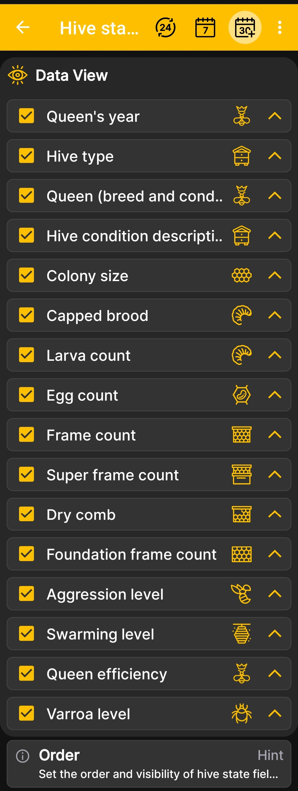

# arı kovanı Devlet Saha Sırası

Bu ekran, genişletilmiş penceredeki alanların görünürlüğünü ve sırasını kontrol eder. [arı kovanı durumu](hive-state.md).

1. Açık **Ana Menü → Ayarlar → arı kovanı durumu alanları sırası**.
2. Görüntülemek istediğiniz bilgilerin yanındaki onay kutularını seçili tutun.
3. Arılığınızda kullanılmayan alanların onay kutularını temizleyin.
4. Daha önemli alanları daha yükseğe taşımak için sağdaki okları kullanın.

{ .doc-screenshot }

Örneğin ana arının yılı, koloni gücü veya çerçeve sayısının gösterimi değiştirilebilir. Tüm alanlar [kovan durumu](hive-state.md) sayfasında açıklanır.

Sıranın değiştirilmesi, verilerin uygulamada nasıl sunulduğunu etkiler ancak saklanan arı kovanı kayıtlarını değiştirmez.
