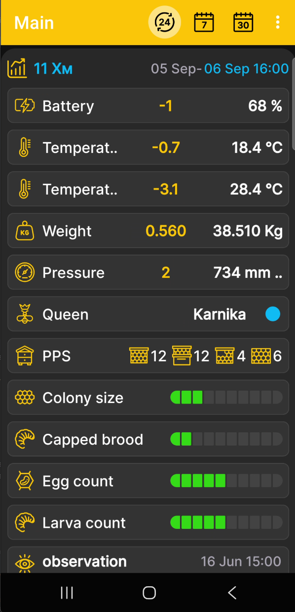
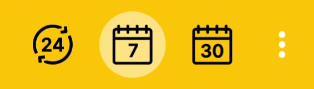

# Uygulama Ana Ekranı

Ana ekran, seçilen arı kovanı veya kovanı için sayısal okumaları, arı kovanı durumunu ve son olayları bir araya getirir. BeeApiary arı kovanı tartı terazileri. Uygulamanın ayrı bir ölçüm ekranı yoktur: mevcut tüm veriler, arı kovanının birleşik bir tanımını oluşturur.

{ .doc-screenshot }

## Ekranda Görünenler

- seçilen arı kovanı veya BeeApiary arı kovanı tartı terazileri;
- ilgili veriler mevcut olduğunda ağırlık, sıcaklık, nem, basınç ve pil şarjına ilişkin sayısal okumalar;
- [arı kovanı durumu](hive-state.md), kraliçe, çerçeveler, yavrular ve diğer profil kayıtları;
- en yeni beş [olaylar](events-and-notes.md) kullanıcı tarafından kaydedildi.

Kullanılabilir bloklar seçilen arı kovanı için girilen verilere, sensörlere ve bilgilere bağlıdır.

Kutucuk görünürlüğü ve sırası altında yapılandırılır [Veri ve Grafikleri Seçin](chart-settings.md). Zamanla değişen sayısal değerler de şu şekilde görüntülenebilir: [çizelgeler](charts.md). Bir [ayrı saha ayarı](hive-state-settings.md) arı kovanı durumu için mevcuttur.

## Dönem ve Değerler

Üstteki simgelere tekrar tekrar dokunarak gün, hafta veya ay sayısını seçin.

{ .doc-screenshot .period-selection-icons width="314" height="89" }

Bitiş tarihini seçmek için kovan bölümündeki tarih ve saate dokunun. Bkz. [Grafik görüntüleme dönemi](chart-period.md).

Her sayısal okuma için:

- seçilen dönemin sonundaki en son ölçüm sağda beyaz renkte görünür;
- seçilen periyodun başındaki ve sonundaki değerler arasındaki değişim veya delta sarı renkte görünür.

## Hızlı Gezinme

Açılan pencereyi açmak için seçilen arı kovanı başlığına kısaca dokunun. [çizelgeler](charts.md). Açmak için başlığa dokunup basılı tutun [veri seçimi ve grafik sırası](chart-settings.md).

- Açmak için sola kaydırın [arı kovanı durumu](hive-state.md), yeni bir kayıt ekleyin veya mevcut kaydı güncelleyin.
- Açmak için sağa kaydırın [olaylar ve notlar](events-and-notes.md), yeni bir etkinlik ekleyin veya mevcut bir etkinliği düzenleyin.
