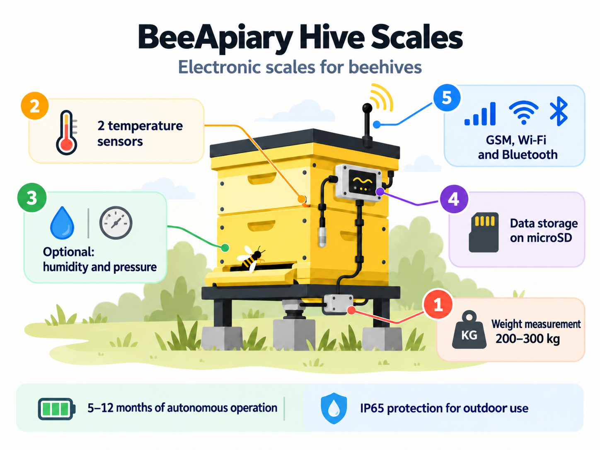
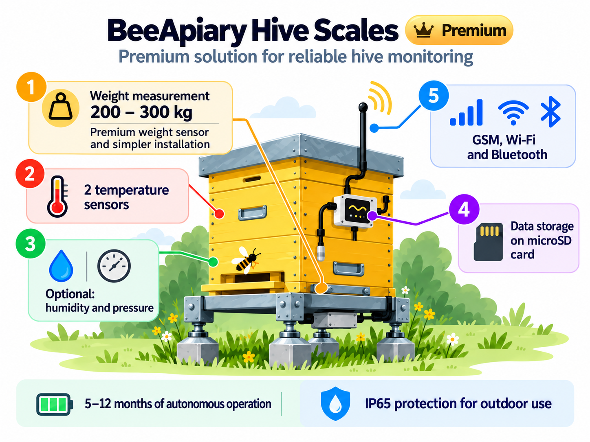

# BeeApiary Kovan Tartısı Modelleri ve Ek Seçenekler

BeeApiary kovan tartıları iki temel yapılandırmayla sunulur. Listelenen seçenekler isteğe bağlı olarak her iki yapılandırmaya da eklenebilir.

### **Temel model**

[Temel modeli sipariş verin veya satın alın](https://www.olx.ua/d/obyavlenie/vagi-paschn-apiary-scales-vesy-pasechnye-vesy-gsm-wi-fi-dlya-paseki-IDUTO1F.html)

{ .doc-photo width="1500" height="1049" loading="lazy" decoding="async" }

Yapılandırma dört yük sensörü ve iki sıcaklık sensörü içerir.

{ .model-option-image width="1448" height="1086" loading="lazy" decoding="async" }

### **Destekli geliştirilmiş model ("küçük artı")**

[Destekli geliştirilmiş modeli sipariş verin veya satın alın](https://apkua.com/ru/agroboard/i-535929/vesy-pasechnye-vesy-gsm-wi-fi-dlya-paseki)

{ .doc-photo width="1327" height="1186" loading="lazy" decoding="async" }

Yapılandırma özel bir destek, sıcaklık kompanzasyonlu geliştirilmiş bir yük sensörü ve iki sıcaklık sensörü içerir.

{ .model-option-image width="1448" height="1086" loading="lazy" decoding="async" }

## Ek seçenekler

| Ek seçenek | Fotoğraf | Yaklaşık fiyat |
|---|---|---|
| Ek güçlendirilmiş batarya |  | ≈ 12 USD |
| Periyodik şarj için güneş paneli |  | ≈ 12 USD |
| 3 m kablolu uzatılmış anten |  | ≈ 12 USD |
| Nem ve basınç sensörü |  | ≈ 12 USD |
| Küçük OLED ekran |  | ≈ 12 USD |
| Hareket sensörü |  | ≈ 12 USD |

Belirtilen fiyatlar yaklaşıktır. Seçeneklerin bulunabilirliği, seçilen yapılandırmayla uyumluluğu ve nihai fiyat sipariş sırasında doğrulanmalıdır.

<noscript>Hesaplayıcı için JavaScript gereklidir.</noscript>
