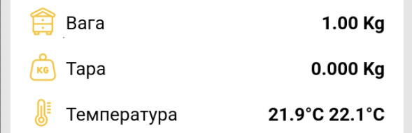

# Kalibrasyon ve Dara

!!! danger "Yeni bir cihazın kalibrasyona ihtiyacı yoktur"
    Kalibrasyon öncelikle bir onarımdan veya fabrika kalibrasyon verilerinin kaybolmasından sonra gereklidir. Yanlış ağırlık okumasında sorun gidermenin genel bir yolu olarak kullanmayın.

## Kalibrasyon

1. Harici güç kaynağının bağlantısını kesin.
2. Tüm ağırlık sensörlerini sağlam, düz bir yüzeye yerleştirin ve platformu boş bırakın.
3. Cihazın erişim noktasına bağlanın ve açın **Genel Ayarlar → Tartı Ayarları** web arayüzünde.

    { .doc-screenshot }

4. Başlat **Sıfır Kalibrasyon** ve platforma dokunmadan bitmesini bekleyin.

    Ekranda iki kalibrasyon aşaması gösterilir:

    { .doc-screenshot }

    { .doc-screenshot }

5. 500, 1000 veya 5000 g'lık mevcut bir referans ağırlığı seçin ve bunu platforma yerleştirin.

    { .doc-screenshot }

6. Başlat **Referans Kalibrasyonu** ve sonucu bekleyin.

    { .doc-screenshot }

    { .doc-screenshot }

Sonuç: Cihaz yeni kalibrasyon değerlerini kaydetti. Referans ağırlığının görüntülendiğini kontrol edin.

## Dara

Dara alma, platformun veya başka bir sabit yapının ağırlığını ölçüm dışında bırakır.

1. [Tartının web arayüzüne bağlanın](../guides/configure-local-wifi.md).
2. **Genel ayarlar → Tartı ayarları** bölümünü açın.
3. Bir yöntem seçin:

    - Dara ağırlığı biliniyorsa gram cinsinden girip **Dara ağırlığını ayarla** seçeneğini seçin.

        { .doc-screenshot }

    - Veya yapıyı sensörlerin üzerinde bırakıp mevcut değeri sıfır olarak kabul edin.

        { .doc-screenshot }

4. İşlem bitince göstergeyi kontrol edin.

Sonuç: Cihaz sonraki ölçümlerden darayı düşer. Dara alma fabrika kalibrasyon katsayısını değiştirmez.
