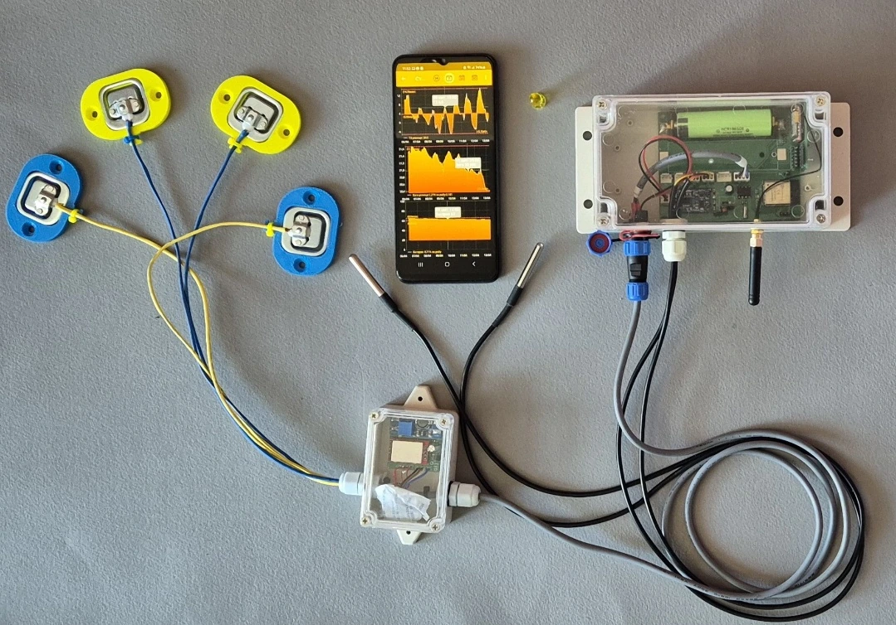

# { .home-brand-logo width="780" height="780" } BeeApiary — kovan tartıları ve arılık izleme { #beeapiary }

BeeApiary, GSM, Wi-Fi ve Bluetooth desteğine sahip kovan tartıları ve arılık izleme sistemini bir araya getirir. Tartılar, sensörler ve uygulama birlikte kovanların durumunu izlemeye, değişiklikleri incelemeye ve hem arılıkta hem de uzaktan günlük tutmaya yardımcı olur. Uygulama tartılar olmadan da tek başına kullanılabilir.

!!! note "Satın alınabilen tartı modelleri"
    - [Sipariş verin veya satın alın: GSM, Wi-Fi ve Bluetooth özellikli temel kovan tartıları](https://www.olx.ua/d/obyavlenie/vagi-paschn-apiary-scales-vesy-pasechnye-vesy-gsm-wi-fi-dlya-paseki-IDUTO1F.html)
    - [Sipariş verin veya satın alın: GSM, Wi-Fi ve Bluetooth özellikli, destekli ve geliştirilmiş sensörlü kovan tartıları (“minik artı”lı)](https://apkua.com/ru/agroboard/i-535929/vesy-pasechnye-vesy-gsm-wi-fi-dlya-paseki "“Minik artı”, artı şeklindeki destek tabanıdır")
    - [Ek seçenekler](device/additional-options.md)

{ width="1448" height="1086" loading="eager" fetchpriority="high" }

!!! note "Ek video materyalleri"
    - [Şuradaki videolar BeeApiary YouTube kanalı](https://www.youtube.com/@beeApiary)

!!! note "Doğrudan iletişime geçin"
    [{ .contact-qr-code width="240" height="283" loading="lazy" decoding="async" }](https://t.me/IVANBDGILKO) { .contact-qr-code width="350" height="336" loading="lazy" decoding="async" }
    {: .contact-qr-links }

Bir set bağımsız olarak BeeApiary kovan tartısı şeklinde çalışabilir; sensörler ve uygulamayla birlikte ise akıllı bir BeeApiary kovanı oluşturur. Dijital günlükle birlikte uygulamada bir araya getirilen birkaç kovan, akıllı bir BeeApiary arılığı oluşturur. Verilere farklı yollarla erişim, uzun süreli notlar, ölçümler ve olaylar arılığın yaşamına ilişkin bütünlüklü bir görünüm sunar ve arıcının arılarını daha iyi anlamasına yardımcı olur.

## Verileriniz kontrolünüz altında kalır

- Tüm veriler yerel olarak depolanır. Harici sunuculara zorunlu bir bağlantı yoktur, dolayısıyla SIM karta gerek yoktur. ([Ölçüm arşivini indirin](guides/download-archive.md))
- Veriler, yerel bir Wi-Fi ağı aracılığıyla doğrudan arı kovanında mevcuttur, dolayısıyla SIM karta gerek yoktur. ([Tartım terazisinin erişim noktasına bağlanın](guides/configure-local-wifi.md))
- Arılıkta yerel Wi-Fi ağı üzerinden internet üzerinden uzaktan erişim mümkün olduğundan, her cihaz için ayrı bir SIM karta gerek yoktur. ([Arı kovanı Wi-Fi ağı üzerinden iletimi ayarlayın](guides/configure-wifi-sync.md))
- Cihazın yakınında olduğunuzda veriler doğrudan Bluetooth aracılığıyla elde edilebilir. Senkronizasyon otomatik olarak gerçekleşir, dolayısıyla SIM kart gerekmez. ([Bluetooth senkronizasyonunu ayarlama](guides/configure-bluetooth-sync.md))
- Mobil operatör üzerinden erişim de mevcut kalır ve mobil internet gerektirmez. Minimum plana sahip bir SIM kart yeterlidir. ([GSM ve SMS'i ayarlama](guides/configure-gsm.md))

[Verilerin uygulamaya ulaşma yollarını karşılaştırın](system/connectivity.md)

## Başlarken

- [Sistemi kurma](quick-start/full-system.md)
- [Uygulamayı yükleyin](quick-start/app-only.md)
- [Cihazla GSM bağlantısı kurun](quick-start/gsm.md)
- [Yerel Wi-Fi ağına bağlanın](quick-start/local-wifi.md)

## İhtiyacınız olduğunda belgeler

- [kullanarak BeeApiary uygulama](app/index.md)
- [Kurulumu BeeApiary arı kovanı tartı terazileri](device/installation.md)
- [Verilerin aktarılması ve saklanması](system/index.md)
- [Kılavuzlar](guides/index.md)
- [Sorun giderme](troubleshooting/index.md)

{ .doc-photo width="1079" height="754" loading="lazy" decoding="async" }
