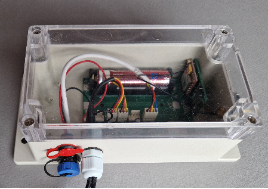
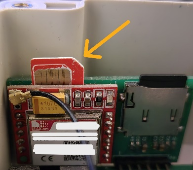
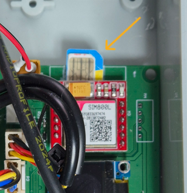
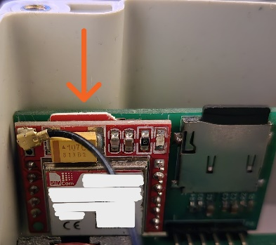
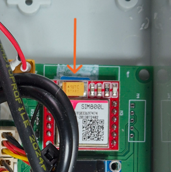

# Sistem Kurulumu

!!! danger "Dikkat: cihaz zaten tam olarak yapılandırılmıştır"
    Yeni BeeApiary Arı kovanı tartım terazileri yapılandırılmış ve kalibre edilmiş olarak sağlanır. Kullanıcı numarası tartım terazisinin ayarlarında zaten kayıtlı olduğundan bunları yeniden yapılandırmanıza gerek yoktur.

    Kendi başınıza değişiklik yapmayın. Genellikle her şeyin işe yaraması için aşağıdaki ilk dört adımı tamamlamanız yeterlidir.

    İlgili talimatları sonuna kadar okumadan pili çıkarmayın, terazinin darasını almayın, kalibre etmeyin veya herhangi bir ayarı değiştirmeyin. İlk kurulum sırasında bunu yapmanız kesinlikle önerilmez.

!!! warning "SIM kartı takmadan önce"
    Yalnızca mikro SIM kullanın ve PIN korumasını önceden devre dışı bırakın.

    { .doc-photo }

1. Veri toplama ünitesinin kapağını açın.

    { .doc-photo }

2. Mikro SIM'i uygun yuvaya takın.

    Doğru kart konumu:

    GSM modülünün konumu, 2026 öncesi eski kartlarda ve 2026'dan itibaren yeni kartlarda farklıdır.

    **Eski kart (2026 öncesi):**

    { .doc-photo }

    **Yeni kart (2026'dan itibaren):**

    { .doc-photo }

    SIM kartı takın ve yuvaya neredeyse tamamen girinceye kadar hafifçe bastırın; yerine kilitlendiğini onaylayan hafif bir tıklama duyuncaya kadar:

    **Eski kart (2026 öncesi):**

    { .doc-photo }

    **Yeni kart (2026'dan itibaren):**

    { .doc-photo }

3. [Cihazı etkinleştirin veya yeniden başlatın](../guides/set-up-device.md#activation-reset): Manyetik anahtarı ana ünitenin arkasındaki marka işaretine kısa süreliğine tutun.

    { .doc-photo }

    { .doc-photo }

4. Yaklaşık bir dakika bekleyin ve ilk SMS'in önceden yapılandırılmış kullanıcı numarasına ulaştığını doğrulayın.

Bitti. Tebrikler: Cihaz veri topluyor, GSM üzerinden gönderiyor ve yerel bir arşiv tutuyor.

## Uygulama – gerekirse

Normal SMS almak için BeeApiary uygulaması gerekli değildir ve uygulama tartının zorunlu bir parçası değildir. Tartı bağımsız çalışır ve verileri SMS ile herhangi bir telefona gönderir. Grafikleri görüntülemek, ölçümleri analiz etmek, arılık günlüğü tutmak, kovanları tanımlamak ve diğer özellikleri kullanmak için uygulamayı yükleyin.

1. [Şunu yükleyin: BeeApiary uygulama](app-only.md) ve SMS mesajlarını işlemesine izin verdiğinizden emin olun.
2. Uygulamada şunu seçin: **Cihaz ekle**.
3. Takılı olan mikro SIM numarasını girin BeeApiary arı kovanı tartı terazileri.

!!! note
    Kullanıcının telefon numarasını değil, cihaza takılı SIM kartın numarasını girin.

İlk SMS gelmezse ayarları rastgele değiştirmeyin. Bkz. [SMS alınmadı](../troubleshooting/no-sms.md). Kullanıcı numarasını şu şekilde değiştirin: [GSM ayarları](../guides/configure-gsm.md) yalnızca gerektiğinde.

- [SIM kart takma: eski kart (2026 öncesi)](https://www.youtube.com/shorts/GF2KLso4DMo)
- [SIM kart takma: yeni kart (2026’dan itibaren)](https://www.youtube.com/watch?v=g_5MQBxkzY0)

Daha fazla bilgi edinin: [GSM ve SMS](../system/gsm-and-sms.md) ve [Veri akışı](../system/data-flow.md).
