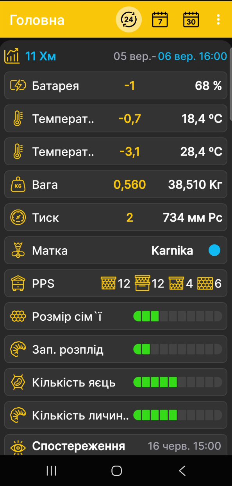

# Головний екран застосунку

Головний екран збирає в одному місці числові показники, стан і останні події для вибраного вулика або пасічних ваг BeeApiary. Окремого екрана вимірювань у застосунку немає: усі доступні дані утворюють спільний опис вулика.

{ .doc-screenshot }

## Що показано на екрані

- вибраний вулик або пасічні ваги BeeApiary;
- числові показники ваги, температури, вологості, тиску й заряду батареї, якщо відповідні дані доступні;
- [стан вулика](hive-state.md), матки, рамок, розплоду та інші записи профілю;
- п'ять останніх [подій](events-and-notes.md), зафіксованих користувачем.

Набір блоків залежить від даних, датчиків і відомостей, заповнених для вибраного вулика.

Видимість і порядок плиток задаються на сторінці [Вибір даних і графіків](chart-settings.md). Числові показники, які змінюються з часом, можуть також відображатися на [графіках](charts.md). Для стану вулика доступне [окреме налаштування полів](hive-state-settings.md).

## Період і значення

Піктограми у верхній частині екрана вибирають кількість діб, тижнів або місяців повторними натисканнями.

{ .doc-screenshot .period-selection-icons width="314" height="89" }

Кінцеву дату можна вибрати натисканням дати й часу у блоці вулика. Докладніше: [Період перегляду графіків](chart-period.md).

Для кожного числового показника:

- праворуч білим показано останнє вимірювання на кінець вибраного періоду;
- жовтим показано зміну, тобто дельту між значеннями на початку й наприкінці вибраного періоду.

## Швидкі переходи

Коротко натисніть заголовок вибраного вулика, щоб відкрити [графіки](charts.md). Натисніть і утримуйте заголовок, щоб перейти до [вибору даних і порядку графіків](chart-settings.md).

- Проведіть пальцем ліворуч, щоб відкрити [стан вулика](hive-state.md), додати новий запис або оновити поточний.
- Проведіть пальцем праворуч, щоб відкрити [події та нотатки](events-and-notes.md), додати нову подію або змінити наявну.
