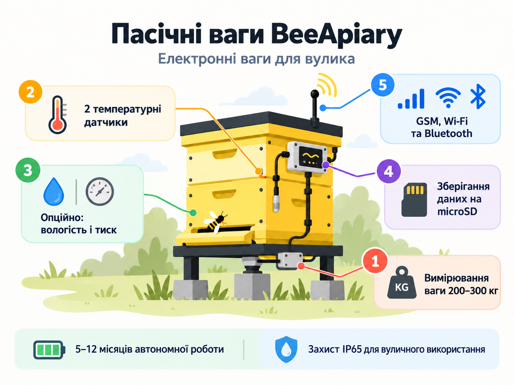
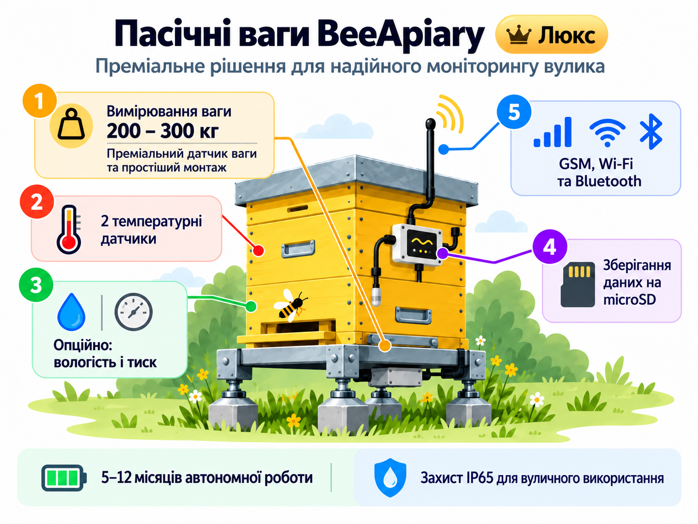
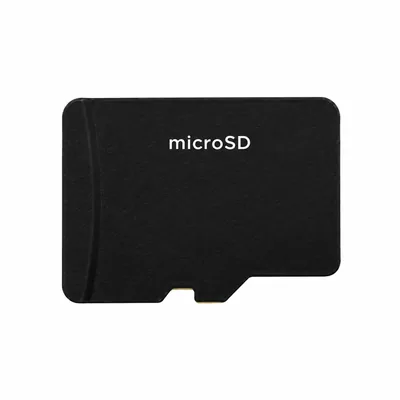
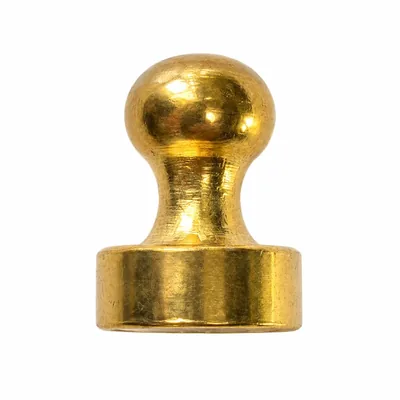

# Моделі та додаткові опції пасічних ваг BeeApiary

Пасічні ваги BeeApiary доступні у двох базових комплектаціях. До кожної з них за бажанням можна додати потрібні опції.

!!! note "Як купити?"
    [**Замовити або купити базову модель**](https://www.olx.ua/d/obyavlenie/vagi-paschn-apiary-scales-vesy-pasechnye-vesy-gsm-wi-fi-dlya-paseki-IDUTO1F.html)
    {: .model-purchase-link }

    [**Замовити або купити покращену модель з опорою**](https://apkua.com/ru/agroboard/i-535929/vesy-pasechnye-vesy-gsm-wi-fi-dlya-paseki)
    {: .model-purchase-link }

### **Базова модель**

{ .doc-photo width="1500" height="1049" loading="lazy" decoding="async" }

Комплектація містить чотири вагові датчики та два датчики температури.

{ .model-option-image width="1448" height="1086" loading="lazy" decoding="async" }

### **Покращена модель з опорою ("плюсіком")**

{ .doc-photo width="1327" height="1186" loading="lazy" decoding="async" }

Комплектація містить спеціальну опору, термокомпенсований покращений ваговий датчик і два датчики температури.

{ .model-option-image width="1448" height="1086" loading="lazy" decoding="async" }

## Базова комплектація

| Назва | Фото | Ціна |
|---|---|---|
| Основний блок | { .option-thumbnail width="400" height="400" loading="lazy" } | входить у комплект |
| Картка пам’яті microSD | { .option-thumbnail width="400" height="400" loading="lazy" } | входить у комплект |
| Два датчики температури | { .option-thumbnail width="400" height="400" loading="lazy" } | входить у комплект |
| Датчик ваги | Залежно від моделі: чотири окремі датчики або один покращений датчик з опорою («плюсіком»). Див. фото моделей вище. | входить у комплект |
| Базова антена | { .option-thumbnail width="400" height="400" loading="lazy" } | входить у комплект |
| Магнітний ключ | { .option-thumbnail width="400" height="400" loading="lazy" } | входить у комплект |
| Базовий елемент живлення | 18650 або інший, залежно від моделі | входить у комплект |

## Додаткові опції

| Додаткова опція | Фото | Орієнтовна ціна |
|---|---|---|
| Додаткова або підсилена батарея | 18650 або інший, залежно від моделі | ≈ 12 USD |
| Сонячна панель для періодичного заряджання | { .option-thumbnail width="400" height="400" loading="lazy" } | ≈ 12 USD |
| Подовжена антена з кабелем 3 м | { .option-thumbnail width="400" height="400" loading="lazy" } | ≈ 12 USD |
| Датчик вологості та тиску | { .option-thumbnail width="400" height="400" loading="lazy" } | ≈ 12 USD |
| Невеликий OLED-екран | { .option-thumbnail width="400" height="400" loading="lazy" } | ≈ 12 USD |
| Датчик руху |  | ≈ 12 USD |

Наведені ціни є орієнтовними. Наявність опцій, сумісність із вибраною комплектацією та остаточну вартість потрібно уточнювати під час замовлення.

<noscript>Для роботи калькулятора потрібен JavaScript.</noscript>
