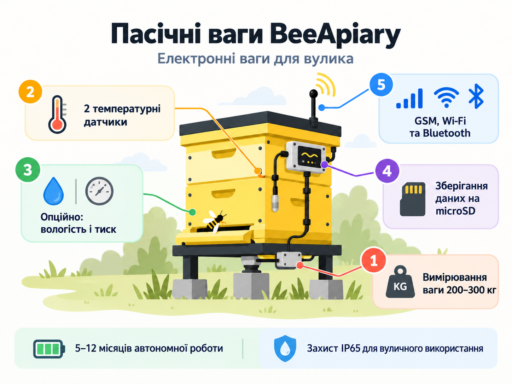
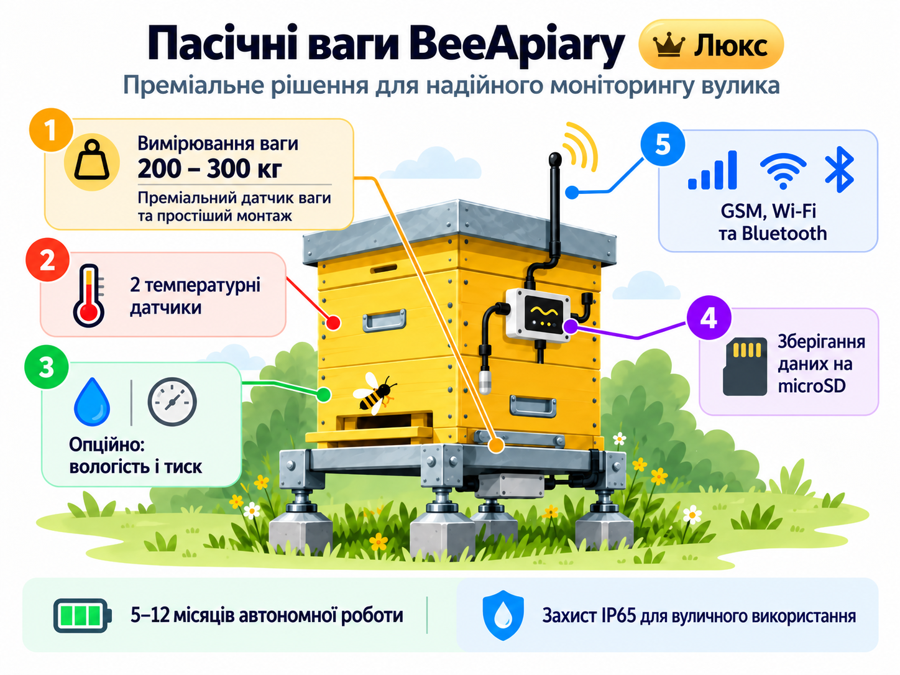

# Моделі та додаткові опції пасічних ваг BeeApiary

Пасічні ваги BeeApiary доступні у двох базових комплектаціях. До кожної з них за бажанням можна додати потрібні опції.

### Базова модель

Комплектація містить чотири вагові датчики та два датчики температури.

[Замовити або купити базову модель](https://www.olx.ua/d/obyavlenie/vagi-paschn-apiary-scales-vesy-pasechnye-vesy-gsm-wi-fi-dlya-paseki-IDUTO1F.html)

{ .model-option-image width="1448" height="1086" loading="lazy" decoding="async" }

### Покращена модель з опорою ("плюсіком")

Комплектація містить спеціальну опору, термокомпенсований покращений ваговий датчик і два датчики температури.

[Замовити або купити покращену модель з опорою](https://apkua.com/ru/agroboard/i-535929/vesy-pasechnye-vesy-gsm-wi-fi-dlya-paseki)

{ .model-option-image width="1448" height="1086" loading="lazy" decoding="async" }

## Додаткові опції

| Додаткова опція | Фото | Орієнтовна ціна |
|---|---|---|
| Додаткова підсилена батарея |  | ≈ 12 USD |
| Сонячна панель для періодичного заряджання |  | ≈ 12 USD |
| Подовжена антена з кабелем 3 м |  | ≈ 12 USD |
| Датчик вологості та тиску |  | ≈ 12 USD |
| Невеликий OLED-екран |  | ≈ 12 USD |
| Датчик руху |  | ≈ 12 USD |

Наведені ціни є орієнтовними. Наявність опцій, сумісність із вибраною комплектацією та остаточну вартість потрібно уточнювати під час замовлення.
