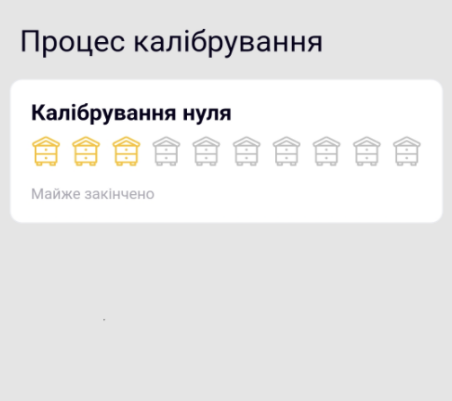
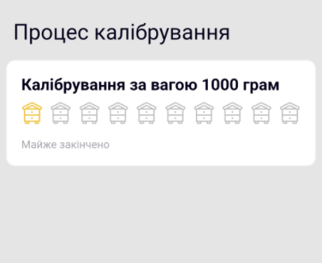
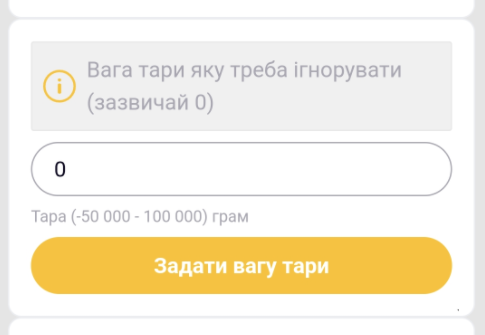
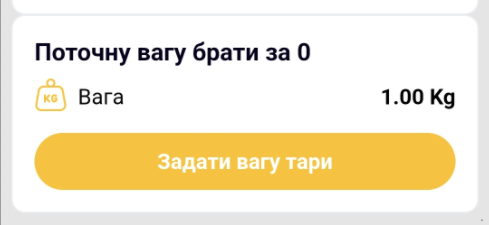

# Калібрування і тарування

!!! danger "Новий пристрій не потрібно калібрувати"
    Калібрування потрібне переважно після ремонту або втрати заводських калібрувальних даних. Не запускайте його як загальний спосіб усунення проблеми з вагою.

## Калібрування

1. Від'єднайте зовнішнє живлення.
2. Установіть усі вагові датчики на твердій горизонтальній поверхні та залиште порожню платформу.
3. Підключіться до точки доступу пристрою й у його вебінтерфейсі відкрийте **Загальні налаштування → Налаштування ваги**.

    { .doc-screenshot }

4. Запустіть **Калібрування нуля** й дочекайтеся завершення, не торкаючись платформи.

    Екран показує два етапи калібрування:

    { .doc-screenshot }

    { .doc-screenshot }

5. Виберіть доступний еталон 500, 1000 або 5000 г і покладіть його на платформу.

    { .doc-screenshot }

6. Запустіть **Калібрування за еталоном** і дочекайтеся результату.

    { .doc-screenshot }

    { .doc-screenshot }

Результат: пристрій зберіг нові калібрувальні значення. Переконайтеся, що відображається вага еталона.

## Тарування

Тарування потрібне, щоб не враховувати вагу платформи або іншої постійної конструкції.

1. [Підключіться до вебінтерфейсу ваг](../guides/configure-local-wifi.md).
2. Відкрийте **Загальні налаштування → Налаштування ваги**.
3. Виберіть один зі способів:

    - Якщо вага тари відома, введіть її в грамах і натисніть **Задати вагу тари**.

        { .doc-screenshot }

    - Або залиште потрібну конструкцію на датчиках і виберіть прийняття поточного значення за нуль.

        { .doc-screenshot }

4. Перевірте показник після завершення.

Результат: пристрій віднімає задану тару від наступних вимірювань. Тарування не змінює заводський коефіцієнт калібрування.
