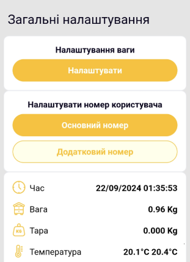
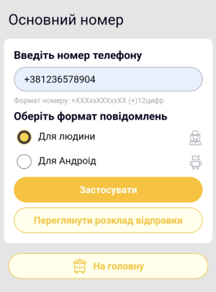
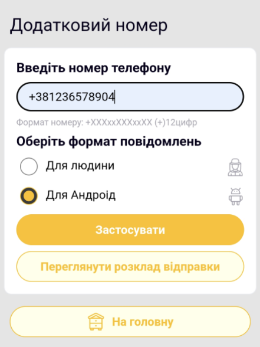
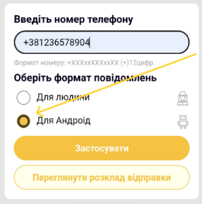
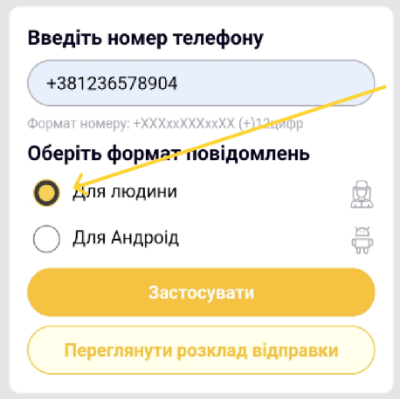
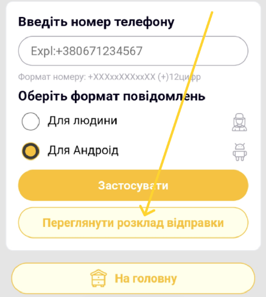
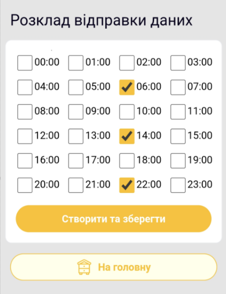
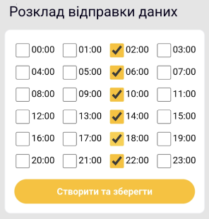
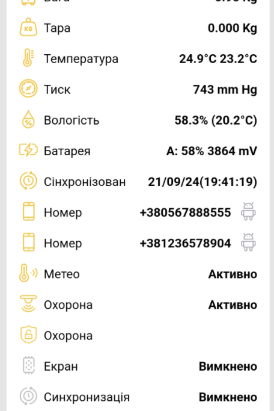

# Як налаштувати GSM

!!! attention "Зверніть увагу"
    Номер користувача зазвичай уже налаштований виробником. Ця інструкція допоможе перевірити, змінити або видалити його за потреби.

1. Переконайтеся, що micro-SIM активна, має покриття й не захищена PIN-кодом.
2. [Підключіться до точки доступу пристрою](configure-local-wifi.md) і відкрийте його вебінтерфейс.

    На сторінці загальних налаштувань вебінтерфейсу пристрою доступні кнопки основного й додаткового номера:

    { .doc-screenshot }

3. Відкрийте налаштування **Основний номер** або **Додатковий номер**.

    { .doc-screenshot }

    { .doc-screenshot }

4. Введіть номер у форматі `+380XXXXXXXXX`.
5. Виберіть **Для людини** для звичайних SMS або **Для Android** для стислих SMS у застосунку.

    { .doc-screenshot }

    { .doc-screenshot }

6. Відкрийте **Переглянути розклад відправки**, виберіть години й натисніть **Створити та зберегти**.

    { .doc-screenshot }

    { .doc-screenshot }

    { .doc-screenshot }

    Після збереження номер відображається у вебінтерфейсі:

    { .doc-screenshot }

    { .doc-screenshot }

7. Від'єднайтеся від `apiary_net` і дочекайтеся першого SMS.

Щоб прибрати номер, задайте `+000000000000`. Формати й розклад описані на сторінці [GSM та SMS](../system/gsm-and-sms.md).
