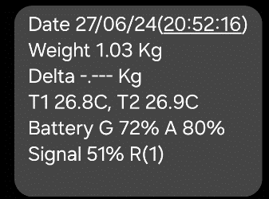
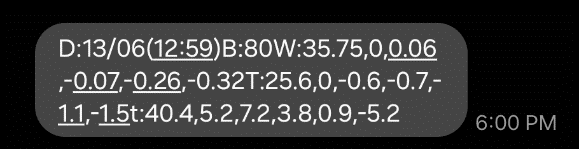

# GSM ваги для вулика — передавання даних через SMS { #gsm-sms }

Пасічні ваги BeeApiary передають вимірювання через SMS для дистанційного контролю пасіки без мобільного Інтернету. GSM ваги для пасіки можуть надсилати звичайні повідомлення для читання на телефоні або стислі — для обробки застосунком.

Пристрій підтримує два номери одержувачів. Для кожного можна окремо вибрати формат:

- звичайний SMS, придатний для читання без застосунку BeeApiary;
- стислий SMS, який застосунок перетворює на набір вимірювань.

У вебінтерфейсі ці формати називаються **Для людини** та **Для Android** відповідно. Їх вибір показаний в [інструкції налаштування GSM](../guides/configure-gsm.md).

У системному застосунку повідомлень Android звичайний SMS містить підписані поточні значення:

{ .doc-screenshot }

Стислий формат об'єднує дані для подальшої обробки застосунком:

{ .doc-screenshot }

Розклад спільний для обох номерів. У вибрані години пристрій вимірює, передає накопичені дані та переходить у режим сну. Не створюйте зайвих відправлень: це витрачає заряд і GSM-трафік.

Для стислого формату рекомендовано передавання приблизно кожні 4–6 годин, щоб не переповнювати SMS і зберегти регулярний графік.

<noscript>Для роботи калькулятора потрібен JavaScript.</noscript>

Налаштування: [Налаштування GSM](../guides/configure-gsm.md). Проблеми: [Не надходять SMS](../troubleshooting/no-sms.md).
